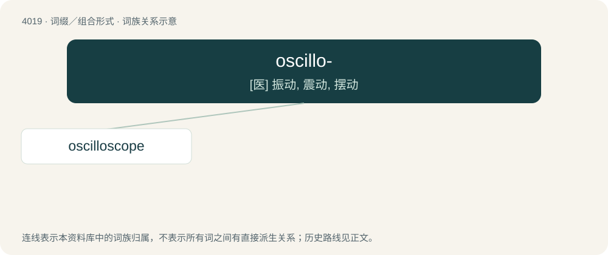

# 4036 · oscillo- — \[医\] 振动, 震动, 摆动

[总目录](../00_总目录_按常用程度.md)

**类型**：词缀／组合形式　｜　**来源语言**：见词源记录

## 核心含义与来源

- 核心含义：\[医\] 振动, 震动, 摆动
- 英文含义：oscillation
- 词形：oscillo-

## 词族图

## 单词速览（常用到不常用）

| 单词 | 音标 | 释义 |
|---|---|---|
| [oscilloscope](#w-1) | 英 /əˈsɪl.ɪ.skəʊp/ | n. 示波镜；\[计\] 示波器 |

## 逐词详解

### 1. oscilloscope

**词性**：名词　｜　**音标**：英 /əˈsɪl.ɪ.skəʊp/

**中文释义**：n. 示波镜；\[计\] 示波器

**英文义项**：An electronic measuring instrument that creates a visible two-dimensional graph, on a screen, of one or more continuously varying voltages or currents.

**构词拆分**：oscillo- + -scope

**词源与演化**：

From oscillo- + -scope.

**例句**：

> Next, try to confirm the deviation with an oscilloscope.
