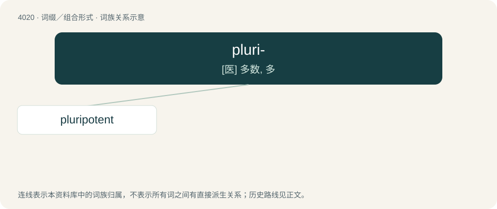

# 4037 · pluri- — \[医\] 多数, 多

[总目录](../00_总目录_按常用程度.md)

**类型**：词缀／组合形式　｜　**来源语言**：见词源记录

## 核心含义与来源

- 核心含义：\[医\] 多数, 多
- 英文含义：several
- 词形：pluri-

**来源记录 1**（前缀／前置成分；several）

From Latin pluri-, combining form of plūris, from plūs, from Old Latin \*plous, from Proto-Indo-European \*pleh₁- (“many”). Related to plenty, plural (via Latin) and fele, full (via PIE).

## 词族图

## 单词速览（常用到不常用）

| 单词 | 音标 | 释义 |
|---|---|---|
| [pluripotent](#w-1) | 英 /plʊəˈɹɪpətənt/ | a. \[生\]多能(性)的 |

## 逐词详解

### 1. pluripotent

**词性**：形容词　｜　**音标**：英 /plʊəˈɹɪpətənt/

**中文释义**：a. \[生\]多能(性)的

**英文义项**：Having much or unlimited potential to develop in a certain way, especially in a desirable fashion. / Able to develop into more than one mature cell or tissue type, but not all.

**构词拆分**：pluri- + potent

**词源与演化**：

From pluri- + potent.
