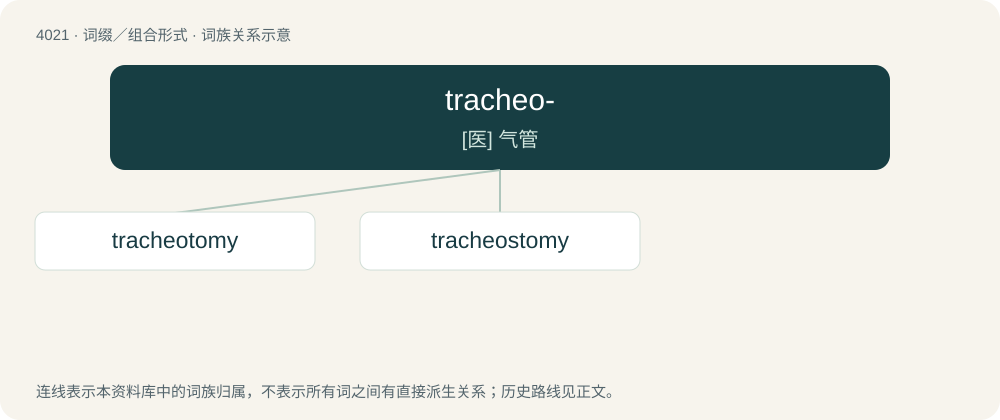

# 4038 · tracheo- — \[医\] 气管

[总目录](../00_总目录_按常用程度.md)

**类型**：词缀／组合形式　｜　**来源语言**：见词源记录

## 核心含义与来源

- 核心含义：\[医\] 气管
- 英文含义：Relating to the trachea.
- 词形：tracheo-

**来源记录 1**（前缀／前置成分；Relating to the trachea.）

From trachea + -o-.

## 词族图

## 单词速览（常用到不常用）

| 单词 | 音标 | 释义 |
|---|---|---|
| [tracheotomy](#w-1) | /,trækiˈɔtəmi/ | n. 气管切开术；\[医\] 气管切开术 |
| [tracheostomy](#w-2) | /.treikiˈɒtəmi/ | n. 气管切开术；\[医\] 气管造口术 |

## 逐词详解

### 1. tracheotomy

**词性**：名词　｜　**音标**：/,trækiˈɔtəmi/

**中文释义**：n. 气管切开术；\[医\] 气管切开术

**英文义项**：A surgical procedure in which an incision is made into the trachea, through the neck, and a tube inserted so as to make an artificial opening in order to assist breathing.

**构词拆分**：tracheo- + -tomy

**词源与演化**：

From tracheo- + -tomy.

### 2. tracheostomy

**词性**：名词　｜　**音标**：/.treikiˈɒtəmi/

**中文释义**：n. 气管切开术；\[医\] 气管造口术

**英文义项**：A surgical procedure in which an incision is made into the trachea, through the neck, and a tube inserted so as to make an artificial opening in order to assist breathing.

**构词拆分**：tracheo- + -stomy

**词源与演化**：

From tracheo- + -stomy.
