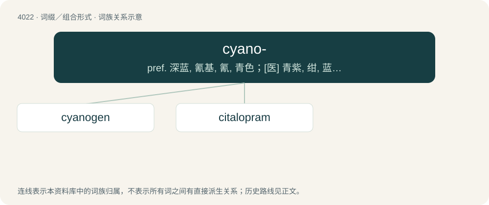

# 4039 · cyano- — pref. 深蓝, 氰基, 氰, 青色；\[医\] 青紫, 绀, 蓝, 氰

[总目录](../00_总目录_按常用程度.md)

**类型**：词缀／组合形式　｜　**来源语言**：见词源记录

## 核心含义与来源

- 核心含义：pref. 深蓝, 氰基, 氰, 青色；\[医\] 青紫, 绀, 蓝, 氰
- 英文含义：dark blue-green in colour
- 词形：cyano-

**来源记录 1**（前缀／前置成分；dark blue-green in colour）

From Ancient Greek κυάνεος (kuáneos, “dark blue”).

## 词族图

## 单词速览（常用到不常用）

| 单词 | 音标 | 释义 |
|---|---|---|
| [cyanogen](#w-1) | /saɪˈæn.ə.d͡ʒɪn/ | n. 氰；\[化\] 氰 |
| [citalopram](#w-2) | 美 /saɪˈtæl.əˌpɹæm/ | 西酞普兰 |

## 逐词详解

### 1. cyanogen

**词性**：名词　｜　**音标**：/saɪˈæn.ə.d͡ʒɪn/

**中文释义**：n. 氰；\[化\] 氰

**英文义项**：The pseudohalogen (CN)₂; a colorless, poisonous gas used as a rocket propellant, an insecticide and in chemical warfare. / The radical -CN.

**构词拆分**：cyano- + -gen

**词源与演化**：

From cyano- + -gen; compare French cyanogène. So called because it produced blue dyes.

### 2. citalopram

**词性**：名词　｜　**音标**：美 /saɪˈtæl.əˌpɹæm/

**中文释义**：西酞普兰

**英文义项**：A drug that functions as a SSRI and is administered orally in the form of its hydrobromide C₂₀H₂₁FN₂O·HBr to treat depression and anxiety. It is marketed under the trademark Celexa.

**构词拆分**：cy(ano)- + (ph)thal(imide) + -o- + pr(opyl)am(ine)

**词源与演化**：

Probably from cy(ano)- + (ph)thal(imide) + -o- + pr(opyl)am(ine).
