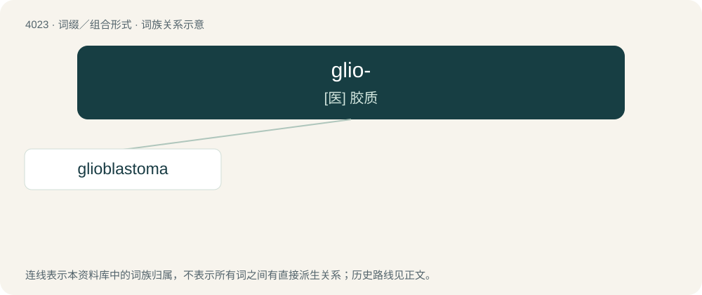

# 4040 · glio- — \[医\] 胶质

[总目录](../00_总目录_按常用程度.md)

**类型**：词缀／组合形式　｜　**来源语言**：见词源记录

## 核心含义与来源

- 核心含义：\[医\] 胶质
- 英文含义：Gliomatous.
- 词形：glio-

**来源记录 1**（前缀／前置成分；Gliomatous.）

# From glia + -o-. # From Ancient Greek γλία (glía, “glue”).

## 词族图

## 单词速览（常用到不常用）

| 单词 | 音标 | 释义 |
|---|---|---|
| [glioblastoma](#w-1) |  | \[医\] 成胶质细胞瘤, 恶性胶质瘤 |

## 逐词详解

### 1. glioblastoma

**词性**：名词

**中文释义**：\[医\] 成胶质细胞瘤, 恶性胶质瘤

**英文义项**：A fast-growing, malignant tumor of the brain.

**构词拆分**：glio- + blastoma

**词源与演化**：

From glio- + blastoma.
