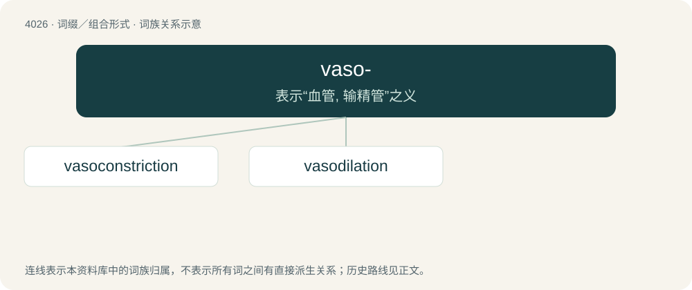

# 4043 · vaso- — 表示“血管, 输精管”之义

[总目录](../00_总目录_按常用程度.md)

**类型**：词缀／组合形式　｜　**来源语言**：见词源记录

## 核心含义与来源

- 核心含义：表示“血管, 输精管”之义
- 英文含义：Pertaining to blood vessels or the vascular system.
- 词形：vaso-

**来源记录 1**（前缀／前置成分；Pertaining to blood vessels or the vascular system.）

From Latin vās + -o-. By surface analysis, vas + -o-.

## 词族图

## 单词速览（常用到不常用）

| 单词 | 音标 | 释义 |
|---|---|---|
| [vasoconstriction](#w-1) | /ˌveɪzəʊkənˈstrɪkʃən/ | n. 血管缩小；\[医\] 血管收缩 |
| [vasodilation](#w-2) | /ˌvæ.sə(ʊ).daɪˈleɪ.ʃ(ə)n/ | \[医\] 血管舒张 |

## 逐词详解

### 1. vasoconstriction

**词性**：名词　｜　**音标**：/ˌveɪzəʊkənˈstrɪkʃən/

**中文释义**：n. 血管缩小；\[医\] 血管收缩

**英文义项**：Constriction or narrowing of a blood vessel.

**构词拆分**：vaso- + constriction

**词源与演化**：

From vaso- + constriction.

### 2. vasodilation

**词性**：名词　｜　**音标**：/ˌvæ.sə(ʊ).daɪˈleɪ.ʃ(ə)n/

**中文释义**：\[医\] 血管舒张

**英文义项**：Dilation or widening of the blood vessels.

**构词拆分**：vaso- + dilation

**词源与演化**：

From vaso- + dilation.
