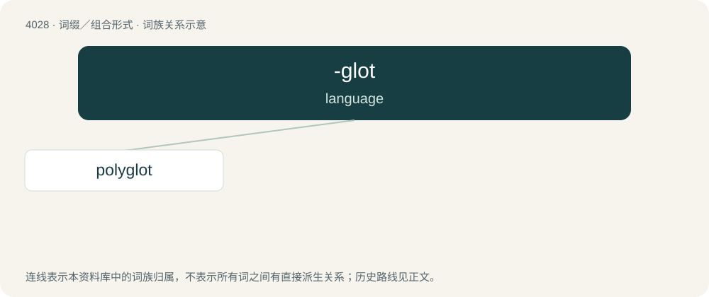

# 4044 · -glot — language

[总目录](../00_总目录_按常用程度.md)

**类型**：词缀／组合形式　｜　**来源语言**：见词源记录

## 核心含义与来源

- 核心含义：language
- 英文含义：language
- 词形：-glot

**来源记录 1**（后缀／后置成分；language）

From Ancient Greek γλῶσσᾰ (glôssă, “tongue; language”).

## 词族图

## 单词速览（常用到不常用）

| 单词 | 音标 | 释义 |
|---|---|---|
| [polyglot](#w-1) | 英 /ˈpɒlɪɡlɒt/；美 /ˈpɑlɪˌɡlɑt/ | a. (使用)多种语言的, 多种文字对照的；n. 使用多种语言的人, 多种文字对照本 |

## 逐词详解

### 1. polyglot

**词性**：形容词　｜　**音标**：英 /ˈpɒlɪɡlɒt/；美 /ˈpɑlɪˌɡlɑt/

**中文释义**：a. (使用)多种语言的, 多种文字对照的；n. 使用多种语言的人, 多种文字对照本

**英文义项**：Of a person: speaking, or versed in, many languages; multilingual. / Containing, or made up of, several languages; specifically, of a book (especially a bible): having text translated into several languages.

**构词拆分**：poly- + -glot

**词源与演化**：

Borrowed from Attic Greek πολύγλωττος (polúglōttos, “speaking many languages, multilingual”), alternative form of Ancient Greek πολῠ́γλωσσος (polŭ́glōssos, “speaking many languages, multilingual”), from πολῠ́ς (polŭ́s, “a lot of, many”) (ultimately from Proto-Indo-European \*pleh₁- (“to fill”)) + Attic Greek γλῶττα (glôtta), Ancient Greek γλῶσσᾰ (glôssă, “tongue; language”) (ultimately from Proto-Indo-European \*glōgʰs (“tip of corn”)) + -ος (-os, suffix forming o-grade action nouns). The English word is analysable as poly- + -glot. Noun sense 1 (“publication in several languages”) is probably derived from Late Latin polyglottus, from Attic Greek πολύγλωττος (polúglōttos): see above.

**例句**：

> A polyglot region without a clearly dominant culture may develop an artificial lingua franca, such as Pidgin English in the South Sea.

该用例对应义项：Comprising various (native) linguistic groups; multilingual.
