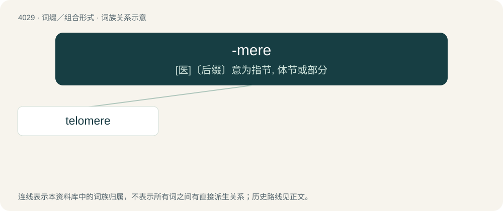

# 4045 · -mere — \[医\]〔后缀〕意为指节, 体节或部分

[总目录](../00_总目录_按常用程度.md)

**类型**：词缀／组合形式　｜　**来源语言**：见词源记录

## 核心含义与来源

- 核心含义：\[医\]〔后缀〕意为指节, 体节或部分
- 英文含义：Forming nouns with the sense of part, segment
- 词形：-mere

**多个词源／构词路径**：同一拼写可能有不同来源；以下按词性和含义分别列出。

**来源记录 1**（后缀／后置成分；Forming nouns with the sense of part, segment）

Derived from Ancient Greek μέρος (méros, “part”).

**来源记录 2**（后缀／后置成分；A lakeside settlement; combining form of mere.）

Identical with moor.

## 词族图

## 单词速览（常用到不常用）

| 单词 | 音标 | 释义 |
|---|---|---|
| [telomere](#w-1) | /ˈtɛləmɪəɹ/ | \[医\] 端粒(染色体) |

## 逐词详解

### 1. telomere

**词性**：名词　｜　**音标**：/ˈtɛləmɪəɹ/

**中文释义**：\[医\] 端粒(染色体)

**英文义项**：Either of the sequences of DNA at each end of a eukaryotic chromosome.

**构词拆分**：telo- (“end”) + -mere (“part”)

**词源与演化**：

From telo- (“end”) + -mere (“part”).
