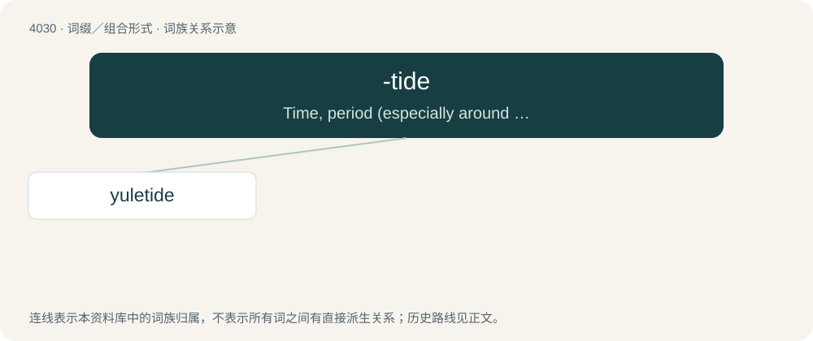

# 4046 · -tide — Time, period (especially around an event or festival), season; often added to a festival name to indicate the period around that festival or a season beginning or ending with it.

[总目录](../00_总目录_按常用程度.md)

**类型**：词缀／组合形式　｜　**来源语言**：见词源记录

## 核心含义与来源

- 核心含义：Time, period (especially around an event or festival), season; often added to a festival name to indicate the period around that festival or a season beginning or ending with it.
- 英文含义：Time, period (especially around an event or festival), season; often added to a festival name to indicate the period around that festival or a season beginning or ending with it.
- 词形：-tide

**多个词源／构词路径**：同一拼写可能有不同来源；以下按词性和含义分别列出。

**来源记录 1**（后缀／后置成分；Time, period (especially around an event or festival), season; often added to a festival name to indicate the period around that festival or a season beginning or ending with it.）

From Middle English -tide, -tyde, from Old English -tīd (in compounds), from tīd (“point or portion of time, due time, period, season; feast-day, canonical hour”); see tide.

**来源记录 2**（后缀／后置成分；Used to form names of peptides and glycopeptides.）

From peptide, glycopeptide.

## 词族图

## 单词速览（常用到不常用）

| 单词 | 音标 | 释义 |
|---|---|---|
| [yuletide](#w-1) | /ˈjuːltaid/ | n. 圣诞季节 |

## 逐词详解

### 1. yuletide

**词性**：名词　｜　**音标**：/ˈjuːltaid/

**中文释义**：n. 圣诞季节

**英文义项**：The flower Camellia sasanqua, native to Japan and nearby islands.

**构词拆分**：Yule (“Germanic Winter Festival”) + -tide (“period around a festival, season”)

**词源与演化**：

From Yule (“Germanic Winter Festival”) + -tide (“period around a festival, season”); compare Swedish juletid.
