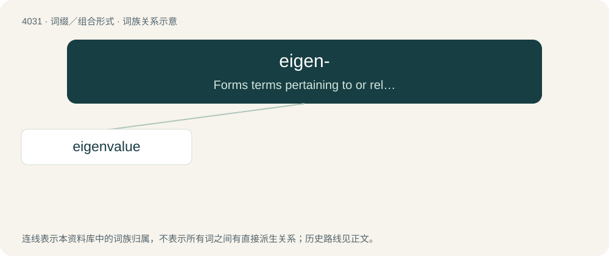

# 4047 · eigen- — Forms terms pertaining to or related to eigenvectors, eigenvalues; especially for naming mathematical objects which are not affected by a given linear transformation except for by 

[总目录](../00_总目录_按常用程度.md)

**类型**：词缀／组合形式　｜　**来源语言**：见词源记录

## 核心含义与来源

- 核心含义：Forms terms pertaining to or related to eigenvectors, eigenvalues; especially for naming mathematical objects which are not affected by a given linear transformation except for by scalar multiplication.
- 英文含义：Forms terms pertaining to or related to eigenvectors, eigenvalues; especially for naming mathematical objects which are not affected by a given linear transformation except for by scalar multiplication.
- 词形：eigen-

**来源记录 1**（前缀／前置成分；Forms terms pertaining to or related to eigenvectors, eigenvalues; especially for naming mathematical objects which are not affected by a given linear transformation except for by scalar multiplication.）

Borrowed from German eigen (“own”). Many of the compounds represent partial translations from German, e.g. eigenvalue from German Eigenwert. Doublet of own.

## 词族图

## 单词速览（常用到不常用）

| 单词 | 音标 | 释义 |
|---|---|---|
| [eigenvalue](#w-1) | 英 /ˈaɪ.ɡənˌvæl.juː/；美 /ˈaɪ.ɡənˌvæl.ju/ | n. 特征值；\[计\] 本征值 |

## 逐词详解

### 1. eigenvalue

**词性**：名词　｜　**音标**：英 /ˈaɪ.ɡənˌvæl.juː/；美 /ˈaɪ.ɡənˌvæl.ju/

**中文释义**：n. 特征值；\[计\] 本征值

**英文义项**：A scalar λ, such that there exists a non-zero vector x (a corresponding eigenvector) for which the image of x under a given linear transformation A is equal to the image of x under multiplication by λ; i.e. Ax=λx.

**构词拆分**：eigen- + value

**词源与演化**：

From eigen- + value. Partial calque of German Eigenwert.
