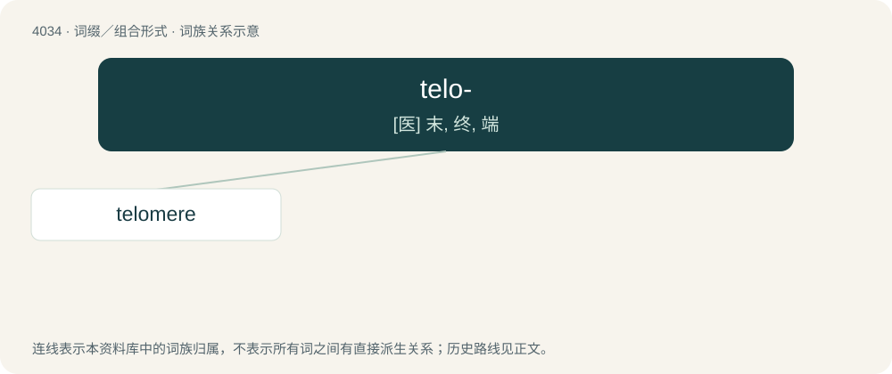

# 4049 · telo- — \[医\] 末, 终, 端

[总目录](../00_总目录_按常用程度.md)

**类型**：词缀／组合形式　｜　**来源语言**：见词源记录

## 核心含义与来源

- 核心含义：\[医\] 末, 终, 端
- 英文含义：end
- 词形：telo-

**来源记录 1**（前缀／前置成分；end）

Borrowed from Ancient Greek τέλος (télos, “end”). Compare teleo-.

## 词族图

## 单词速览（常用到不常用）

| 单词 | 音标 | 释义 |
|---|---|---|
| [telomere](#w-1) | /ˈtɛləmɪəɹ/ | \[医\] 端粒(染色体) |

## 逐词详解

### 1. telomere

**词性**：名词　｜　**音标**：/ˈtɛləmɪəɹ/

**中文释义**：\[医\] 端粒(染色体)

**英文义项**：Either of the sequences of DNA at each end of a eukaryotic chromosome.

**构词拆分**：telo- (“end”) + -mere (“part”)

**词源与演化**：

From telo- (“end”) + -mere (“part”).
