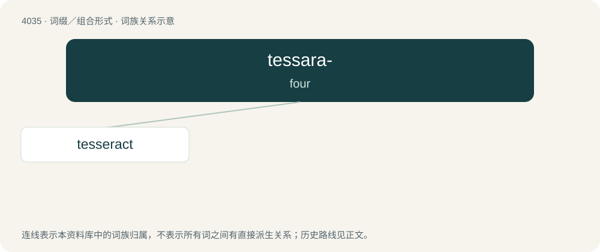

# 4050 · tessara- — four

[总目录](../00_总目录_按常用程度.md)

**类型**：词缀／组合形式　｜　**来源语言**：见词源记录

## 核心含义与来源

- 核心含义：four
- 英文含义：four
- 词形：tessara-

**来源记录 1**（前缀／前置成分；four）

From the Ancient Greek τέσσᾰρᾰ (téssără), the neuter plural and combining form of τέσσᾰρες (téssăres, “four”); compare tetra-.

## 词族图

## 单词速览（常用到不常用）

| 单词 | 音标 | 释义 |
|---|---|---|
| [tesseract](#w-1) | /ˈtɛ.səˌɹækt/ | n. \[数\]立方体的四维模拟, 超正方体 |

## 逐词详解

### 1. tesseract

**词性**：名词　｜　**音标**：/ˈtɛ.səˌɹækt/

**中文释义**：n. \[数\]立方体的四维模拟, 超正方体

**英文义项**：The four-dimensional analogue of a cube; a 4D polytope bounded by eight cubes (analogously to the way a cube is bounded by six squares). / Any of various fictional mechanisms that explain extradimensional, superluminal, or time travel outside the geometry of the physical universe.

**构词拆分**：tessara- (“four-”) + Ancient Greek ἀκτίς (aktís, “ray”)

**词源与演化**：

Word created by Charles Howard Hinton, in his book A New Era of Thought published in 1888, from Ancient Greek tessara- (“four-”) + Ancient Greek ἀκτίς (aktís, “ray”).
