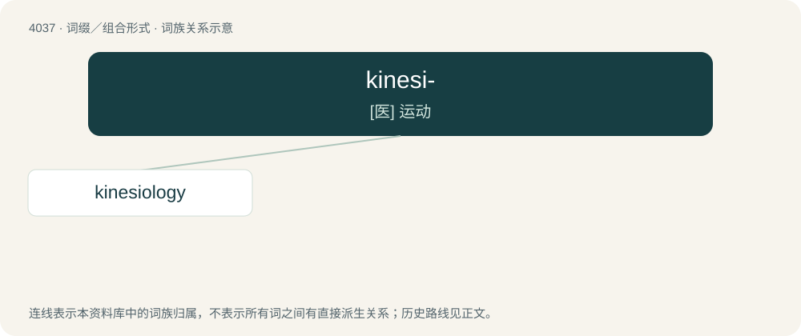

# 4052 · kinesi- — \[医\] 运动

[总目录](../00_总目录_按常用程度.md)

**类型**：词缀／组合形式　｜　**来源语言**：见词源记录

## 核心含义与来源

- 核心含义：\[医\] 运动
- 英文含义：movement, especially the movement of human body parts.
- 词形：kinesi-

**来源记录 1**（前缀／前置成分；movement, especially the movement of human body parts.）

From Ancient Greek κῑ́νησῐς (kī́nēsĭs, “movement, motion”).

## 词族图

## 单词速览（常用到不常用）

| 单词 | 音标 | 释义 |
|---|---|---|
| [kinesiology](#w-1) | /kəˌni.ziˈɔ.lə.d͡ʒɪ/ | n. 运动机能学；\[医\] 运动学 |

## 逐词详解

### 1. kinesiology

**词性**：名词　｜　**音标**：/kəˌni.ziˈɔ.lə.d͡ʒɪ/

**中文释义**：n. 运动机能学；\[医\] 运动学

**英文义项**：The study of body movement. / The application of such principles to the diagnosis and treatment of muscular imbalance.

**构词拆分**：kinesi- + -ology

**词源与演化**：

From kinesi- + -ology.

**例句**：

> Kinesiology is the study of movement.
