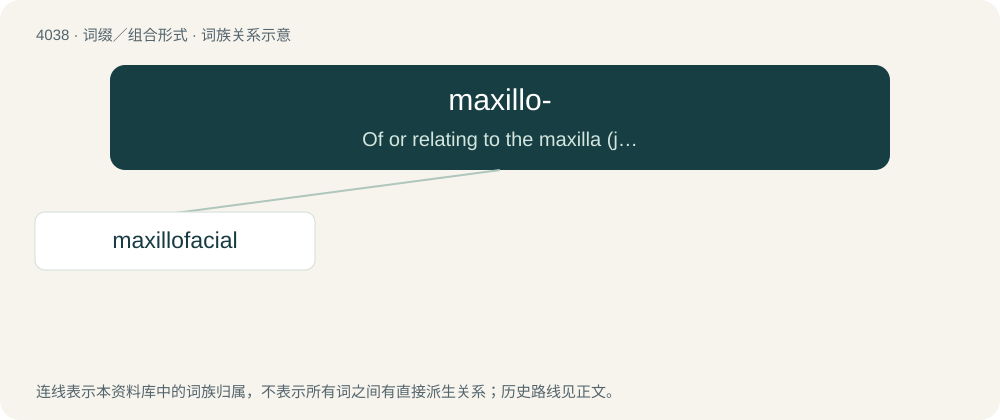

# 4053 · maxillo- — Of or relating to the maxilla (jaw).

[总目录](../00_总目录_按常用程度.md)

**类型**：词缀／组合形式　｜　**来源语言**：见词源记录

## 核心含义与来源

- 核心含义：Of or relating to the maxilla (jaw).
- 英文含义：Of or relating to the maxilla (jaw).
- 词形：maxillo-

**来源记录 1**（前缀／前置成分；Of or relating to the maxilla (jaw).）

Ultimately from Latin māxilla.

## 词族图

## 单词速览（常用到不常用）

| 单词 | 音标 | 释义 |
|---|---|---|
| [maxillofacial](#w-1) | /mæk,siləuˈtəːbinəl/ | \[医\] 上颌面的 |

## 逐词详解

### 1. maxillofacial

**词性**：形容词　｜　**音标**：/mæk,siləuˈtəːbinəl/

**中文释义**：\[医\] 上颌面的

**英文义项**：Of or relating to the jaw and face.

**构词拆分**：maxillo- + facial

**词源与演化**：

From maxillo- + facial.
