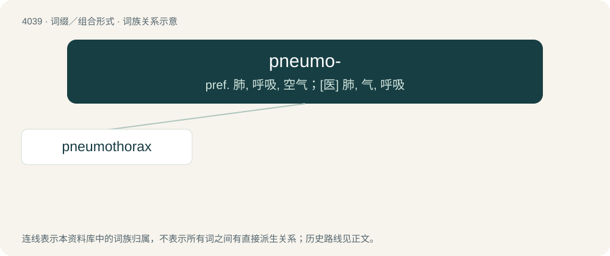

# 4054 · pneumo- — pref. 肺, 呼吸, 空气；\[医\] 肺, 气, 呼吸

[总目录](../00_总目录_按常用程度.md)

**类型**：词缀／组合形式　｜　**来源语言**：见词源记录

## 核心含义与来源

- 核心含义：pref. 肺, 呼吸, 空气；\[医\] 肺, 气, 呼吸
- 英文含义：Relating to the lungs.
- 词形：pneumo-

**多个词源／构词路径**：同一拼写可能有不同来源；以下按词性和含义分别列出。

**来源记录 1**（前缀／前置成分；Relating to the lungs.）

From Ancient Greek πνεύμων (pneúmōn, “lung”).

**来源记录 2**（前缀／前置成分；Relating to air.）

From Ancient Greek πνεῦμα (pneûma, “air”).

## 词族图

## 单词速览（常用到不常用）

| 单词 | 音标 | 释义 |
|---|---|---|
| [pneumothorax](#w-1) | 英 /ˈnjuː.məʊˌθɔ.ɹæks/；美 /ˈnju.moʊˌθɔ.ɹæks/ | n. 气胸；\[医\] 气胸 |

## 逐词详解

### 1. pneumothorax

**词性**：名词　｜　**音标**：英 /ˈnjuː.məʊˌθɔ.ɹæks/；美 /ˈnju.moʊˌθɔ.ɹæks/

**中文释义**：n. 气胸；\[医\] 气胸

**英文义项**：Presence of air inside the pleural cavity, usually caused by injury either to the lung or the chest wall.

**构词拆分**：pneumo- + thorax

**词源与演化**：

From pneumo- + thorax.

**例句**：

> This tall and thin young man had a spontaneous pneumothorax.
