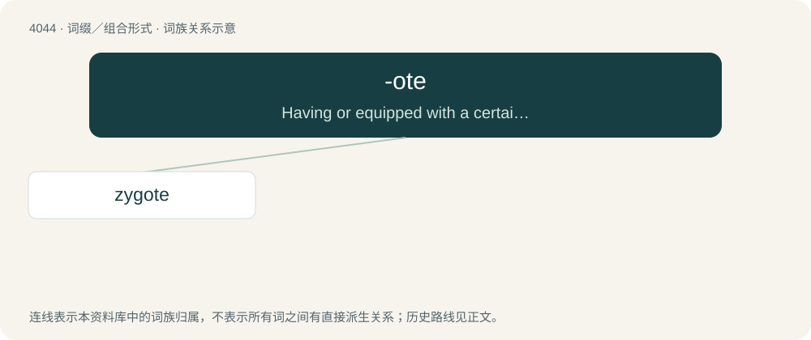

# 4060 · -ote — Having or equipped with a certain feature or structure.

[总目录](../00_总目录_按常用程度.md)

**类型**：词缀／组合形式　｜　**来源语言**：见词源记录

## 核心含义与来源

- 核心含义：Having or equipped with a certain feature or structure.
- 英文含义：Having or equipped with a certain feature or structure.
- 词形：-ote

**来源记录 1**（后缀／后置成分；Having or equipped with a certain feature or structure.）

From Ancient Greek -ωτά (-ōtá), neuter plural of -ωτός (-ōtós), verbal adjective from the stem of -όω (-óō, denominal verb suffix). Related to translingual -ota.

## 词族图

## 单词速览（常用到不常用）

| 单词 | 音标 | 释义 |
|---|---|---|
| [zygote](#w-1) | 英 /ˈzaɪɡəʊt/；美 /ˈzaɪˌɡoʊt/ | n. 合子, 受精卵；\[医\] 合子 |

## 逐词详解

### 1. zygote

**词性**：名词　｜　**音标**：英 /ˈzaɪɡəʊt/；美 /ˈzaɪˌɡoʊt/

**中文释义**：n. 合子, 受精卵；\[医\] 合子

**英文义项**：A eukaryotic cell formed from the fusion of two gametes (“reproductive cells”) during a fertilization process.

**词源与演化**：

Learned borrowing from Ancient Greek ζῠγωτός (zŭgōtós, “yoked”) + English -ote (suffix meaning ‘having \[the thing to which it is attached\]’). Ζῠγωτός (Zŭgōtós) is derived from ζῠγόω (zŭgóō, “to join or yoke together”) + -τός (-tós, suffix forming adjectives of possibility); and ζῠγόω (zŭgóō) from ζῠγόν (zŭgón, “yoke for joining animals; anything which joins two things together”) (ultimately from Proto-Indo-European \*yewg- (“to tie together, join, yoke”)) + -όω (-óō, suffix forming causative or factitive verbs). By surface analysis, zygo- + -ote.
