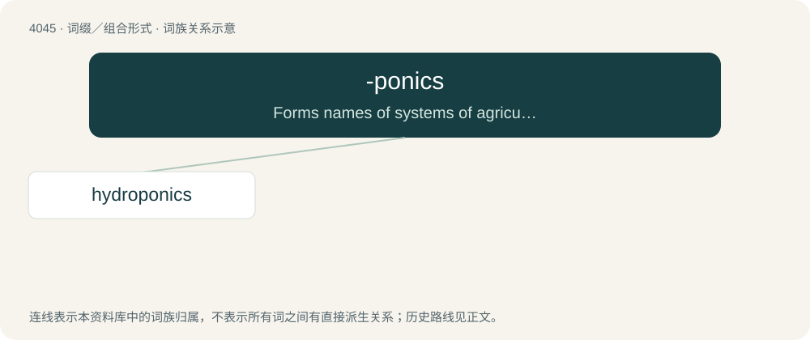

# 4061 · -ponics — Forms names of systems of agriculture.

[总目录](../00_总目录_按常用程度.md)

**类型**：词缀／组合形式　｜　**来源语言**：见词源记录

## 核心含义与来源

- 核心含义：Forms names of systems of agriculture.
- 英文含义：Forms names of systems of agriculture.
- 词形：-ponics

**来源记录 1**（后缀／后置成分；Forms names of systems of agriculture.）

From geoponics (“agriculture”), which is ultimately from Ancient Greek γεω- (geō-, “earth”) + πόνος (pónos, “work, toil”) + -ικός (-ikós).

## 词族图

## 单词速览（常用到不常用）

| 单词 | 音标 | 释义 |
|---|---|---|
| [hydroponics](#w-1) | 英 /ˌhaɪdɹə(ʊ)ˈpɒnɪks/；美 /ˌhaɪdɹəˈpɑnɪks/ | n. 水耕法, 水栽培 |

## 逐词详解

### 1. hydroponics

**词性**：名词　｜　**音标**：英 /ˌhaɪdɹə(ʊ)ˈpɒnɪks/；美 /ˌhaɪdɹəˈpɑnɪks/

**中文释义**：n. 水耕法, 水栽培

**英文义项**：The cultivation of plants in a nutrient solution rather than in the soil.

**构词拆分**：hydro- (“water”) + -ponics

**词源与演化**：

From hydro- (“water”) + -ponics, which is from geoponics.
