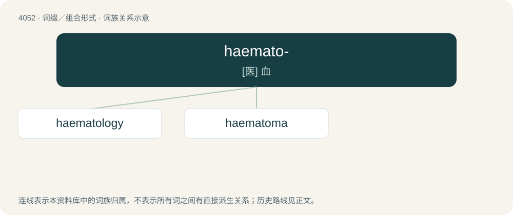

# 4066 · haemato- — \[医\] 血

[总目录](../00_总目录_按常用程度.md)

**类型**：词缀／组合形式　｜　**来源语言**：见词源记录

## 核心含义与来源

- 核心含义：\[医\] 血
- 英文含义：blood
- 词形：haemato-

**来源记录 1**（前缀／前置成分；blood）

Representing the combining form of Ancient Greek αἷμα (haîma, “blood”).

## 词族图

## 单词速览（常用到不常用）

| 单词 | 音标 | 释义 |
|---|---|---|
| [haematology](#w-1) | 英 /ˌhiːməˈtɒlədʒi/；美 /ˌhiməˈtɑləd͡ʒi/ | n. (=hematology)血液学, 血液病学 |
| [haematoma](#w-2) | /,hiːməˈtəumə/ | n. (=hematoma)\[医\]血肿 |

## 逐词详解

### 1. haematology

**词性**：名词　｜　**音标**：英 /ˌhiːməˈtɒlədʒi/；美 /ˌhiməˈtɑləd͡ʒi/

**中文释义**：n. (=hematology)血液学, 血液病学

**英文义项**：The scientific study of blood and blood-producing organs.

**构词拆分**：haemat- + -ology；hæmat- + -ology；haemato- + -logy

**词源与演化**：

From haemat- + -ology or hæmat- + -ology or haemato- + -logy.

### 2. haematoma

**词性**：名词　｜　**音标**：/,hiːməˈtəumə/

**中文释义**：n. (=hematoma)\[医\]血肿

**英文义项**：UK standard spelling of hematoma.

**构词拆分**：haemato- + -oma

**词源与演化**：

From haemato- + -oma.
