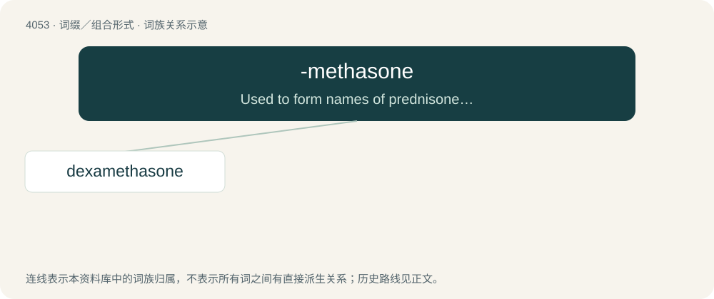

# 4067 · -methasone — Used to form names of prednisone and prednisolone derivatives.

[总目录](../00_总目录_按常用程度.md)

**类型**：词缀／组合形式　｜　**来源语言**：见词源记录

## 核心含义与来源

- 核心含义：Used to form names of prednisone and prednisolone derivatives.
- 英文含义：Used to form names of prednisone and prednisolone derivatives.
- 词形：-methasone

**来源记录 1**（后缀／后置成分；Used to form names of prednisone and prednisolone derivatives.）

From meth- + -a- + (predni)s(ol)one.

## 词族图

## 单词速览（常用到不常用）

| 单词 | 音标 | 释义 |
|---|---|---|
| [dexamethasone](#w-1) | 英 /ˌdɛk.səˈmɛθ.ə.səʊn/；美 /ˌdɛk.səˈmɛθ.əˌsoʊn/ | \[化\] 地塞米松；\[医\] 地塞米松, 氟甲强的松龙, 9α-氟-16α-甲基强的松龙 |

## 逐词详解

### 1. dexamethasone

**词性**：名词　｜　**音标**：英 /ˌdɛk.səˈmɛθ.ə.səʊn/；美 /ˌdɛk.səˈmɛθ.əˌsoʊn/

**中文释义**：\[化\] 地塞米松；\[医\] 地塞米松, 氟甲强的松龙, 9α-氟-16α-甲基强的松龙

**英文义项**：A synthetic member of the glucocorticoid-class of steroid hormones, having the chemical formula C₂₂H₂₉FO₅, and used especially as an anti-inflammatory agent.

**构词拆分**：From dex- + -a- + -methasone (“prednisone or prednisolone derivative”).

**词源与演化**：

From dex- + -a- + -methasone (“prednisone or prednisolone derivative”).

**例句**：

> Many dexamethasones act as anti-inflammatory agents.

该用例对应义项：A synthetic member of the glucocorticoid-class of steroid hormones, having the chemical formula C₂₂H₂₉FO₅, and used especially as an anti-inflammatory agent.
