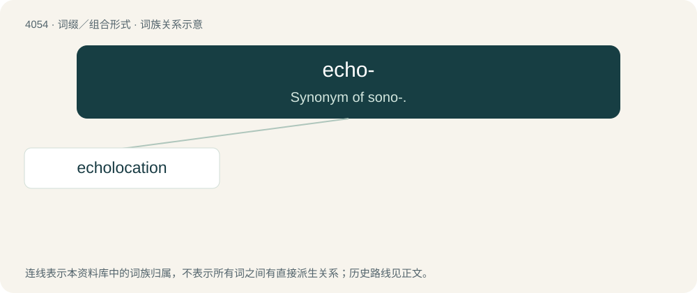

# 4068 · echo- — Synonym of sono-.

[总目录](../00_总目录_按常用程度.md)

**类型**：词缀／组合形式　｜　**来源语言**：见词源记录

## 核心含义与来源

- 核心含义：Synonym of sono-.
- 英文含义：Synonym of sono-.
- 词形：echo-

**来源记录 1**（前缀／前置成分；Synonym of sono-.）

Derived from Ancient Greek ἠχώ (ēkhṓ, “echo, protracted sound”).

## 词族图

## 单词速览（常用到不常用）

| 单词 | 音标 | 释义 |
|---|---|---|
| [echolocation](#w-1) | 美 /ˌɛkoʊloʊˈkeɪʃən/ | \[医\] 回声测定 |

## 逐词详解

### 1. echolocation

**词性**：名词　｜　**音标**：美 /ˌɛkoʊloʊˈkeɪʃən/

**中文释义**：\[医\] 回声测定

**英文义项**：The use of echoes to detect objects as observed in bats and other natural creatures.

**构词拆分**：echo- + location

**词源与演化**：

Coined by American zoologist Donald Griffin in 1944, from echo- + location.

**例句**：

> The bat's echolocation allows it to navigate in the dark.
