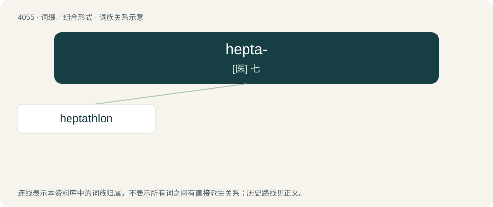

# 4069 · hepta- — \[医\] 七

[总目录](../00_总目录_按常用程度.md)

**类型**：词缀／组合形式　｜　**来源语言**：见词源记录

## 核心含义与来源

- 核心含义：\[医\] 七
- 英文含义：Seven.
- 词形：hepta-

**来源记录 1**（前缀／前置成分；Seven.）

From Ancient Greek ἑπτά (heptá, “seven”).

## 词族图

## 单词速览（常用到不常用）

| 单词 | 音标 | 释义 |
|---|---|---|
| [heptathlon](#w-1) | /hɛpˈtæθlɒn/ | n. 七项全能 |

## 逐词详解

### 1. heptathlon

**词性**：名词　｜　**音标**：/hɛpˈtæθlɒn/

**中文释义**：n. 七项全能

**英文义项**：An athletic contest comprising seven events; contested mostly by women, for whom this is an Olympic sport.

**构词拆分**：hepta- + -athlon

**词源与演化**：

From hepta- + -athlon.
