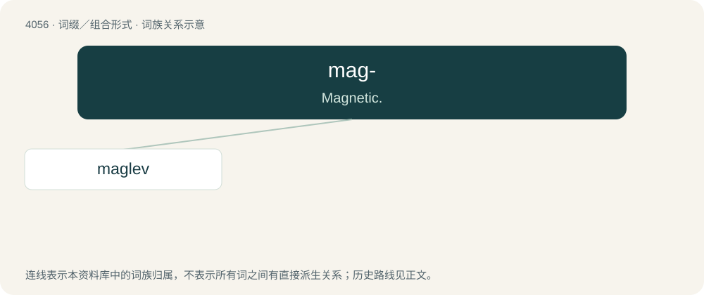

# 4070 · mag- — Magnetic.

[总目录](../00_总目录_按常用程度.md)

**类型**：词缀／组合形式　｜　**来源语言**：见词源记录

## 核心含义与来源

- 核心含义：Magnetic.
- 英文含义：Magnetic.
- 词形：mag-

**来源记录 1**（前缀／前置成分；Magnetic.）

Clipping of magnet or magnetic.

## 词族图

## 单词速览（常用到不常用）

| 单词 | 音标 | 释义 |
|---|---|---|
| [maglev](#w-1) | /ˈmæɡ.lɛv/ | n. & adj.磁力悬浮火车(的) |

## 逐词详解

### 1. maglev

**词性**：形容词　｜　**音标**：/ˈmæɡ.lɛv/

**中文释义**：n. & adj.磁力悬浮火车(的)

**英文义项**：Describing a train, system, etc, that operates by magnetic levitation.

**构词拆分**：mag- + lev(itation)

**词源与演化**：

Syllabic abbreviation of magnetic levitation, equivalent to mag- + lev(itation).

**例句**：

> Technology isn't everything, but it impresses me if an ethnic group can put their own space station up or build the fastest maglev trains.
