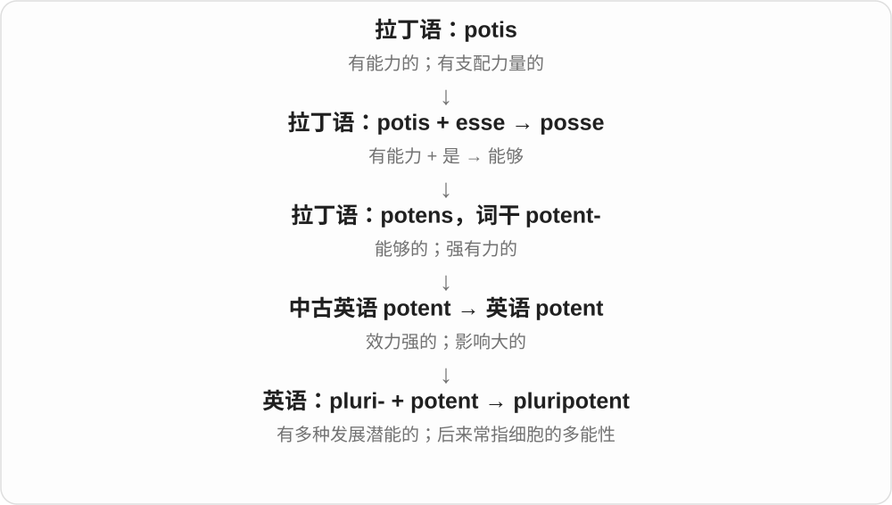

# 4072 · pluri- — 多个、较多

[逐词精讲目录](../00_逐词精讲目录.md) · [总目录](../00_总目录_按常用程度.md)

## 核心词根与来源

来自拉丁 plus 更多及 pluris 等词形的组合材料 pluri-；近代科学与表示能力的 potent 等结合。

**PLURI-：具有不止一种可能、能力的数量材料**

pluripotent 多能的，生物学中常用于能分化出多种细胞类型的细胞。前部给多，后部给能力。

- **多种分化潜能**：pluripotent

## 词形与演化规律

pluri- 多 + potent 有能力 → pluripotent。完整术语在干细胞生物学中有明确范围，不能仅凭多就扩成任何能力。

## 单词速览（按词族由简到繁）

同一基础词的相关扩展放在一起，先读基础形式，再读扩展；各组之间优先读常用的。具体词源关系见各词讲解。

| 单词 | 音标 | 核心意思 |
|---|---|---|
| [pluripotent](#w-1) | 英 /ˌplʊərɪˈpəʊtənt/；美 /ˌplʊrɪˈpoʊtənt/ | 多能的；能分化成身体各类细胞的 |

## 逐词讲解

### 1. pluripotent — 多能的；能分化成身体各类细胞的

**音标**：英 /ˌplʊərɪˈpəʊtənt/；美 /ˌplʊrɪˈpoʊtənt/

**先抓住这个画面**

pluripotent 像一个还没定专业的学生，能走向身体里的许多不同“职业”。

**怎么拆**

pluri- 多、许多 + potent 有能力的，英语科学构词；前一成分来自拉丁语。

**怎么变成今天的意思**

现代干细胞语境中，pluripotent 细胞能形成身体各主要细胞类型，但不能据此说它单独就能形成完整个体及全部胚外组织。诱导多能干细胞常简称 iPS cells。

**常见搭配与例句**

pluripotent stem cells；induced pluripotent stem cells；remain pluripotent。

> The laboratory studies how pluripotent cells become specialized.

实验室研究多能细胞如何变成专门化细胞。

> The researchers created induced pluripotent stem cells from skin cells.

研究者利用皮肤细胞制备了诱导多能干细胞。

**别混淆**

pluripotent 的分化范围比 multipotent 更广；totipotent 还涉及形成完整个体所需的胚外组织等能力。中文有时都带“多能”，要看英文区别。

## 这一组要分清什么

pluripotent 是多能，不等同于 totipotent 全能这一术语；两者都含能力材料，但分化潜能范围不同。

## 串起来练习

The lecture discusses pluripotent stem cells.

讲座讨论了多能干细胞。
