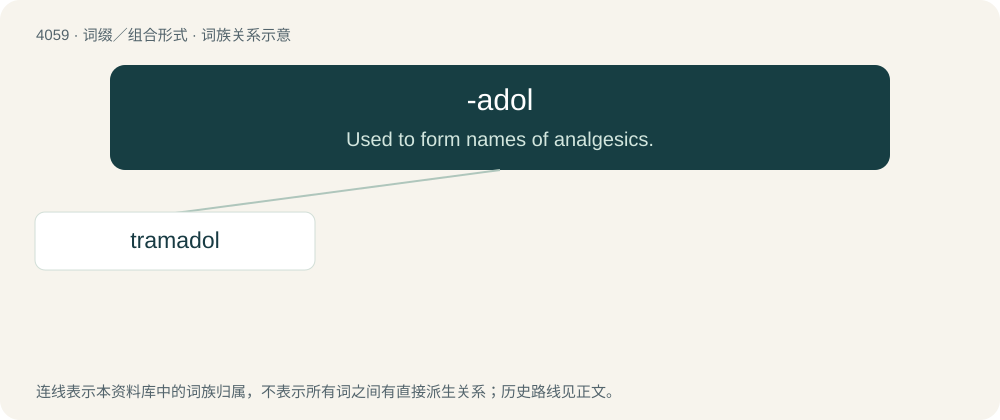

# 4073 · -adol — Used to form names of analgesics.

[总目录](../00_总目录_按常用程度.md)

**类型**：词缀／组合形式　｜　**来源语言**：见词源记录

## 核心含义与来源

- 核心含义：Used to form names of analgesics.
- 英文含义：Used to form names of analgesics.
- 词形：-adol

**来源记录 1**（后缀／后置成分；Used to form names of analgesics.）

From methadol.

## 词族图

## 单词速览（常用到不常用）

| 单词 | 音标 | 释义 |
|---|---|---|
| [tramadol](#w-1) | 美 /ˈtɹæm.əˌdɔl/ | \[化\] 曲马朵; 反胺苯环醇 |

## 逐词详解

### 1. tramadol

**词性**：名词　｜　**音标**：美 /ˈtɹæm.əˌdɔl/

**中文释义**：\[化\] 曲马朵; 反胺苯环醇

**英文义项**：A synthetic opioid analgesic administered orally in the form of its hydrochloride C₁₆H₂₅NO₂·HCl to treat moderate to severe pain.

**构词拆分**：trama + -adol

**词源与演化**：

From trama (“the fleshy portion of a basidiocarp”) + -adol (“an analgesic”).
