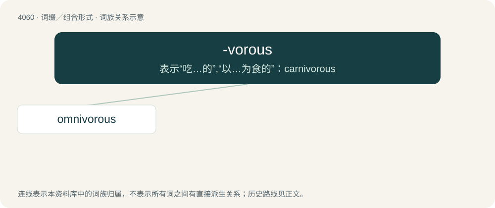

# 4074 · -vorous — 表示“吃…的”,“以…为食的”：carnivorous

[总目录](../00_总目录_按常用程度.md)

**类型**：词缀／组合形式　｜　**来源语言**：见词源记录

## 核心含义与来源

- 核心含义：表示“吃…的”,“以…为食的”：carnivorous
- 英文含义：forming adjectives with the sense of ‘habitually eating, feeding on’
- 词形：-vorous

**来源记录 1**（后缀／后置成分；forming adjectives with the sense of ‘habitually eating, feeding on’）

From Latin -vorus, equivalent to -vore + -ous.

## 词族图

## 单词速览（常用到不常用）

| 单词 | 音标 | 释义 |
|---|---|---|
| [omnivorous](#w-1) | /ɑmˈnɪ.vɝ.əs/ | a. 无所不吃的, 杂食的, 什么都喜欢的 |

## 逐词详解

### 1. omnivorous

**词性**：形容词　｜　**音标**：/ɑmˈnɪ.vɝ.əs/

**中文释义**：a. 无所不吃的, 杂食的, 什么都喜欢的

**英文义项**：Having a diet which is neither exclusively carnivorous nor exclusively herbivorous. / Having an interest in a variety of subjects.

**构词拆分**：omni- + -vorous

**词源与演化**：

From omni- + -vorous.

**例句**：

> Jane Goodall discovered that chimpanzees are omnivorous, not vegetarian.
