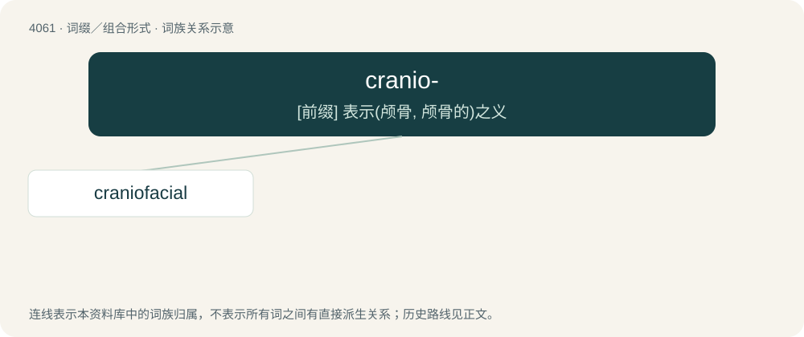

# 4075 · cranio- — \[前缀\] 表示(颅骨, 颅骨的)之义

[总目录](../00_总目录_按常用程度.md)

**类型**：词缀／组合形式　｜　**来源语言**：见词源记录

## 核心含义与来源

- 核心含义：\[前缀\] 表示(颅骨, 颅骨的)之义
- 英文含义：Forms terms relating to the cranium (skull).
- 词形：cranio-

## 词族图

## 单词速览（常用到不常用）

| 单词 | 音标 | 释义 |
|---|---|---|
| [craniofacial](#w-1) | 英 /kɹeɪ.nɪ.əˈfeɪ.ʃəl/ | \[医\] 颅面的 |

## 逐词详解

### 1. craniofacial

**词性**：形容词　｜　**音标**：英 /kɹeɪ.nɪ.əˈfeɪ.ʃəl/

**中文释义**：\[医\] 颅面的

**英文义项**：Of or relating to the cranium and face, as with craniofacial surgery.

**构词拆分**：cranio- + facial

**词源与演化**：

From cranio- + facial.
