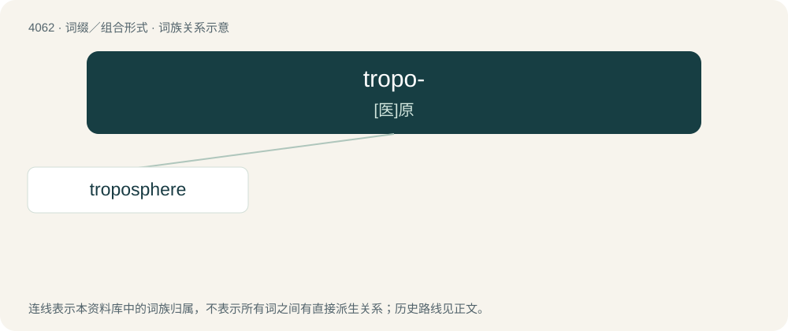

# 4076 · tropo- — \[医\]原

[总目录](../00_总目录_按常用程度.md)

**类型**：词缀／组合形式　｜　**来源语言**：见词源记录

## 核心含义与来源

- 核心含义：\[医\]原
- 英文含义：Characterized by or related to turning motion.
- 词形：tropo-

**来源记录 1**（前缀／前置成分；Characterized by or related to turning motion.）

From Ancient Greek τρόπος (trópos, “turn, way, manner, style”).

## 词族图

## 单词速览（常用到不常用）

| 单词 | 音标 | 释义 |
|---|---|---|
| [troposphere](#w-1) | 英 /ˈtɹɒpəsfɪə/；美 /ˈtɹoʊpəsfɪɚ/ | n. 对流层；\[医\] 对流层 |

## 逐词详解

### 1. troposphere

**词性**：名词　｜　**音标**：英 /ˈtɹɒpəsfɪə/；美 /ˈtɹoʊpəsfɪɚ/

**中文释义**：n. 对流层；\[医\] 对流层

**英文义项**：The lower levels of the atmosphere extending from the surface of the Earth or another celestial body up to the tropopause. It is characterized by convective air movements and a large vertical temperature change.

**构词拆分**：tropo- + -sphere

**词源与演化**：

Borrowed from French troposphère. Equivalent to tropo- + -sphere.

**例句**：

> The troposphere contains three-quarters of the mass of the entire atmosphere.
