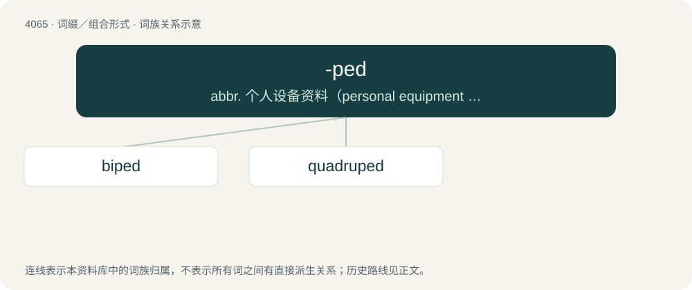

# 4077 · -ped — abbr. 个人设备资料（personal equipment data）；石油工程管理局（Petroleum Engineering Directorate）

[总目录](../00_总目录_按常用程度.md)

**类型**：词缀／组合形式　｜　**来源语言**：见词源记录

## 核心含义与来源

- 核心含义：abbr. 个人设备资料（personal equipment data）；石油工程管理局（Petroleum Engineering Directorate）
- 英文含义：Suffix indicating an organism or person with a specified number or type of feet.
- 词形：-ped

**来源记录 1**（后缀／后置成分；Suffix indicating an organism or person with a specified number or type of feet.）

Partly from French ‑pède and partly from Latin pedis (genitive of pēs (“foot”)).

## 词族图

## 单词速览（常用到不常用）

| 单词 | 音标 | 释义 |
|---|---|---|
| [biped](#w-1) | /ˈbaɪpɛd/ | n. 两足动物；a. 有两足的 |
| [quadruped](#w-2) | 英 /ˈkwɒdɹəpɛd/；美 /ˈkwɑdɹəˌpɛd/ | n. 四足动物；\[医\] 四足的, 四足动物 |

## 逐词详解

### 1. biped

**词性**：名词　｜　**音标**：/ˈbaɪpɛd/

**中文释义**：n. 两足动物；a. 有两足的

**英文义项**：An animal, being, or construction that goes about on two feet (or two legs).

**构词拆分**：bi- + -ped

**词源与演化**：

Borrowed from Latin bipēs, bipedis. Alternatively analyzable as bi- + -ped.

**例句**：

> A man is a featherless biped.

### 2. quadruped

**词性**：名词　｜　**音标**：英 /ˈkwɒdɹəpɛd/；美 /ˈkwɑdɹəˌpɛd/

**中文释义**：n. 四足动物；\[医\] 四足的, 四足动物

**英文义项**：A four-footed or four-legged animal. / A mammal ambulating on all fours.

**构词拆分**：quadru- + -ped

**词源与演化**：

Borrowed from French quadrupède, from Middle French, from Latin stem of quadrupēs (“four-footed, a four-footed animal”), from quadri- (“four-”) + stem of pes (“foot”). Alternatively analyzable as quadru- + -ped. Doublet of tetrapod.
