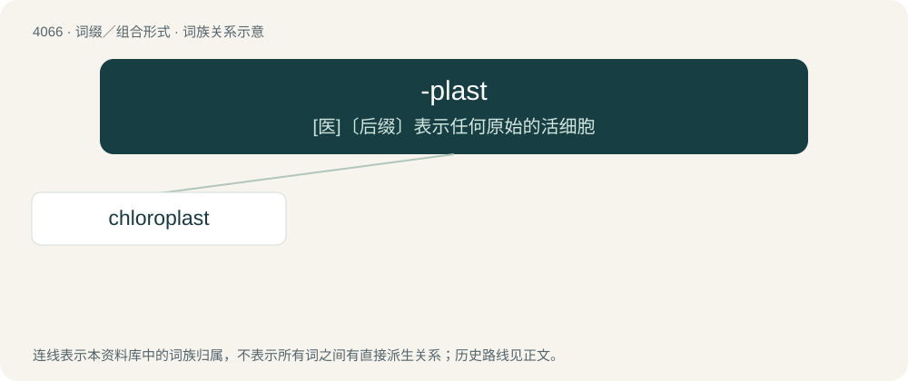

# 4078 · -plast — \[医\]〔后缀〕表示任何原始的活细胞

[总目录](../00_总目录_按常用程度.md)

**类型**：词缀／组合形式　｜　**来源语言**：见词源记录

## 核心含义与来源

- 核心含义：\[医\]〔后缀〕表示任何原始的活细胞
- 英文含义：A small body, structure, particle, or granule, especially of living matter.
- 词形：-plast

**来源记录 1**（后缀／后置成分；A small body, structure, particle, or granule, especially of living matter.）

Derived from Ancient Greek πλᾰστός (plăstós, “molded, formed”).

## 词族图

## 单词速览（常用到不常用）

| 单词 | 音标 | 释义 |
|---|---|---|
| [chloroplast](#w-1) | /ˈklɔːɹəʊˌplæst/ | n. 叶绿体；\[医\] 叶绿粒 |

## 逐词详解

### 1. chloroplast

**词性**：名词　｜　**音标**：/ˈklɔːɹəʊˌplæst/

**中文释义**：n. 叶绿体；\[医\] 叶绿粒

**英文义项**：An organelle, found in the cells of green plants and in photosynthetic algae, where photosynthesis takes place, characterized by a high concentration of chlorophyll and two membranes.

**构词拆分**：chloro- + -plast

**词源与演化**：

From chloro- + -plast.

**例句**：

> The mitochondria and chloroplast were originally prokaryotes.
