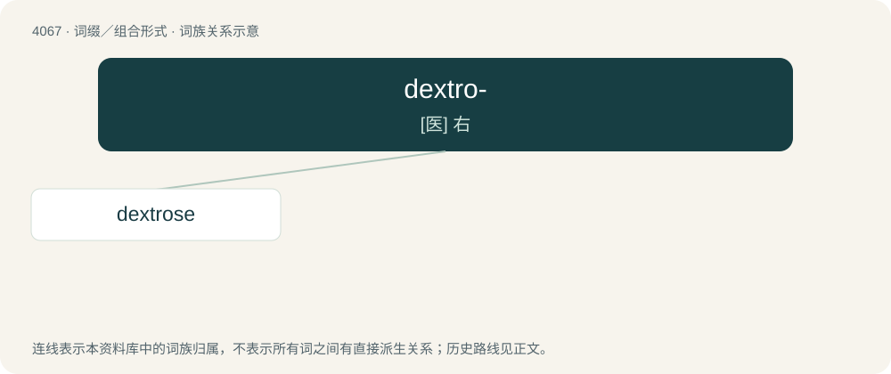

# 4079 · dextro- — \[医\] 右

[总目录](../00_总目录_按常用程度.md)

**类型**：词缀／组合形式　｜　**来源语言**：见词源记录

## 核心含义与来源

- 核心含义：\[医\] 右
- 英文含义：Right; on the right; toward the right.
- 词形：dextro-

**来源记录 1**（前缀／前置成分；Right; on the right; toward the right.）

From Latin dexter (“right”).

## 词族图

## 单词速览（常用到不常用）

| 单词 | 音标 | 释义 |
|---|---|---|
| [dextrose](#w-1) | 英 /ˈdɛkstɹəʊz/ | n. 葡萄糖, 右旋糖；\[化\] 葡萄糖; 葡糖 |

## 逐词详解

### 1. dextrose

**词性**：名词　｜　**音标**：英 /ˈdɛkstɹəʊz/

**中文释义**：n. 葡萄糖, 右旋糖；\[化\] 葡萄糖; 葡糖

**英文义项**：The naturally occurring dextrorotatory form of glucose monosaccharide molecule.

**构词拆分**：dextro- + -ose

**词源与演化**：

From dextro- + -ose (“right-handed sugar”).
