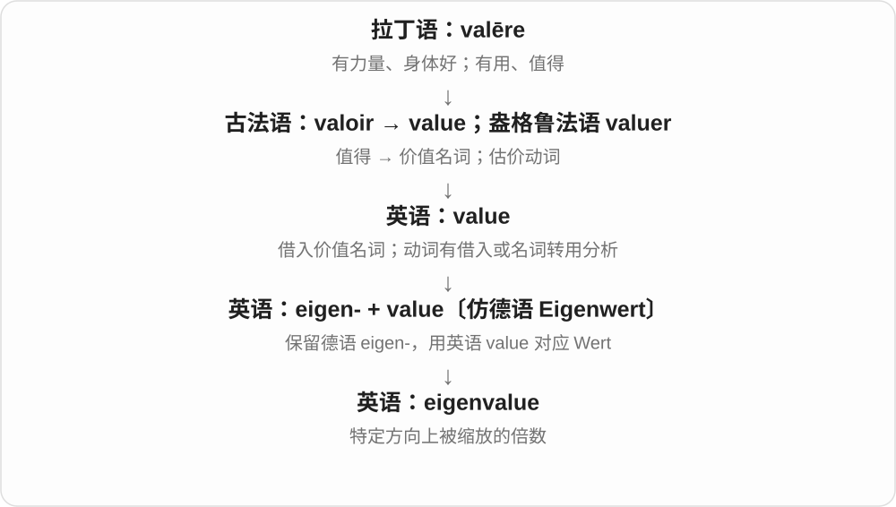

# 4079 · eigen- — 自身的、特有的〔德语材料〕

[逐词精讲目录](../00_逐词精讲目录.md) · [总目录](../00_总目录_按常用程度.md)

## 核心词根与来源

借自德语 eigen 自己的、特有的。eigenvalue 是德语 Eigenwert 的部分翻译：前部保留德语，后部 value 翻译 Wert。

**EIGEN-：某个系统自身具有的特征**

eigenvalue 是特征值。对一个线性变换，某些非零向量经过变换，只变成自身的某个倍数；这个倍数就是特征值，也允许变成零。

- **线性代数中的特征值**：eigenvalue

## 词形与演化规律

德语 Eigenwert → 英语 eigenvalue；eigen- 特有的 + value 值。它是数学术语，不是日常个人价值的评价。

## 单词速览（按词族由简到繁）

同一基础词的相关扩展放在一起，先读基础形式，再读扩展；各组之间优先读常用的。具体词源关系见各词讲解。

| 单词 | 音标 | 核心意思 |
|---|---|---|
| [eigenvalue](#w-1) | 英、美 /ˈaɪɡənˌvæljuː/ | 特征值 |

## 逐词讲解

### 1. eigenvalue — 特征值

**音标**：英、美 /ˈaɪɡənˌvæljuː/

**先抓住这个画面**

某个变换作用在一个非零向量上，只把它沿原来的直线拉长、缩短、反向或压成零；那个倍数就是对应的特征值。

**怎么拆**

部分翻译德语 Eigenwert：eigen-“自身的、特征性的”保留德语，Wert“值”用英语 value 翻译。

**怎么变成今天的意思**

公式 Av = λv 中 v 必须非零，λ 是特征值。它不一定为正，也不一定是实数；“拉伸倍数”是理解实特征值时的直观画面。

**常见搭配与例句**

an eigenvalue of a matrix；compute eigenvalues；a negative eigenvalue。

> The matrix doubles every vector, so its only eigenvalue is two.

这个矩阵把每个向量都放大两倍，所以唯一的特征值是二。

> An eigenvalue of minus one means that the corresponding eigenvector is reversed without changing its length.

特征值为负一，意味着对应特征向量经过变换后方向相反，长度不变。

**别混淆**

eigenvector 是保持在同一直线上的那个向量；eigenvalue 是对应的数，不是向量长度本身。

## 这一组要分清什么

方向图景适合先理解实数情形；正式数学用 Av = λv、v 不为零定义。eigenvalue 是 λ，不能与那个向量 v 混为同一个对象。

## 串起来练习

The students calculated the eigenvalues of the matrix.

学生们计算了这个矩阵的特征值。
