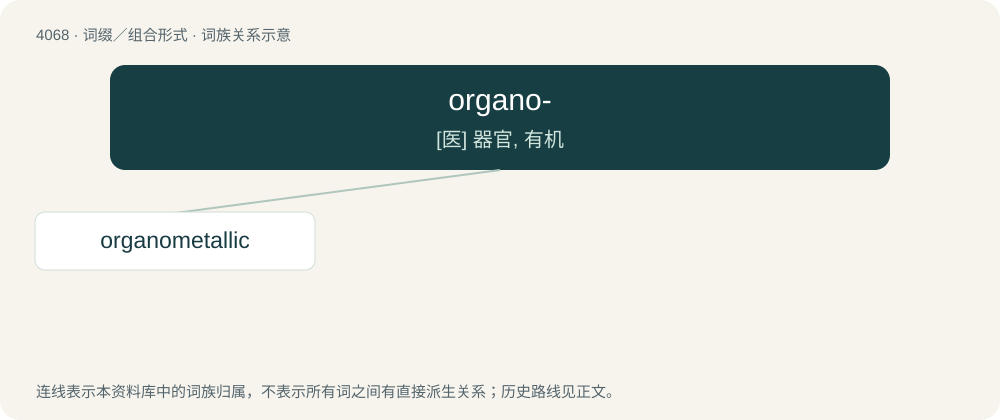

# 4080 · organo- — \[医\] 器官, 有机

[总目录](../00_总目录_按常用程度.md)

**类型**：词缀／组合形式　｜　**来源语言**：见词源记录

## 核心含义与来源

- 核心含义：\[医\] 器官, 有机
- 英文含义：organs of the body
- 词形：organo-

## 词族图

## 单词速览（常用到不常用）

| 单词 | 音标 | 释义 |
|---|---|---|
| [organometallic](#w-1) | /ɔː,gænəʊmɪˈtælɪk/ | a. 有机金属的 |

## 逐词详解

### 1. organometallic

**词性**：形容词　｜　**音标**：/ɔː,gænəʊmɪˈtælɪk/

**中文释义**：a. 有机金属的

**英文义项**：of, or relating to organic compounds having a metal atom directly bonded to a carbon atom

**构词拆分**：From organo- + metallic.

**词源与演化**：

From organo- + metallic.
