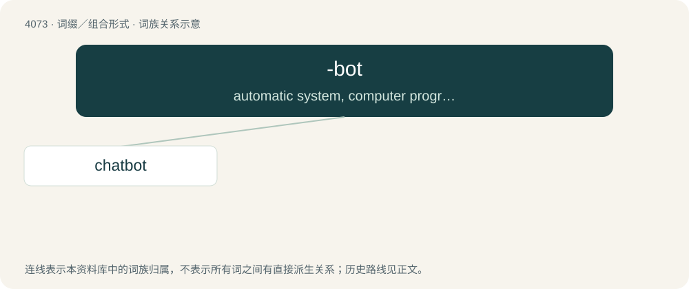

# 4085 · -bot — automatic system, computer program or machine

[总目录](../00_总目录_按常用程度.md)

**类型**：词缀／组合形式　｜　**来源语言**：见词源记录

## 核心含义与来源

- 核心含义：automatic system, computer program or machine
- 英文含义：automatic system, computer program or machine
- 词形：-bot

**来源记录 1**（后缀／后置成分；automatic system, computer program or machine）

From bot, a clipping of robot.

## 词族图

## 单词速览（常用到不常用）

| 单词 | 音标 | 释义 |
|---|---|---|
| [chatbot](#w-1) | Canada /ˈtʃætbɑt/ | 【英文】A computer program that holds conversations through a chat room. |

## 逐词详解

### 1. chatbot

**词性**：名词　｜　**音标**：Canada /ˈtʃætbɑt/

**英文义项**：A computer program that holds conversations through a chat room.

**构词拆分**：chat + -bot

**词源与演化**：

From chat + -bot, from earlier chatterbot.

**例句**：

> The chatbot was quite simple yet informative.

该用例对应义项：A computer program that holds conversations through a chat room.
