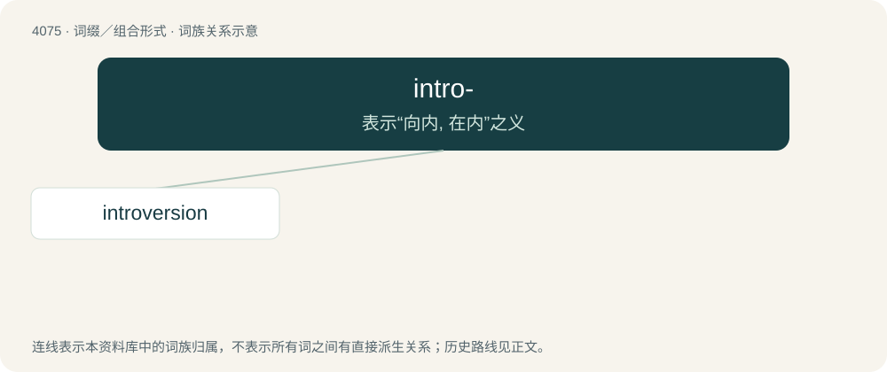

# 4087 · intro- — 表示“向内, 在内”之义

[总目录](../00_总目录_按常用程度.md)

**类型**：词缀／组合形式　｜　**来源语言**：见词源记录

## 核心含义与来源

- 核心含义：表示“向内, 在内”之义
- 英文含义：inward, inwards.
- 词形：intro-

**来源记录 1**（前缀／前置成分；inward, inwards.）

From Latin intro- (“inwards”), from intro (“inward, inwards”), q.v.

## 词族图

## 单词速览（常用到不常用）

| 单词 | 音标 | 释义 |
|---|---|---|
| [introversion](#w-1) | 英 /ɪntɹəʊˈvɜːʃən/；美 /ɪntɹəˈvəɹʒən/ | n. 内向性, 内省；\[医\] 内翻, 向内, \[精神\]内向 |

## 逐词详解

### 1. introversion

**词性**：名词　｜　**音标**：英 /ɪntɹəʊˈvɜːʃən/；美 /ɪntɹəˈvəɹʒən/

**中文释义**：n. 内向性, 内省；\[医\] 内翻, 向内, \[精神\]内向

**英文义项**：A turning inward, particularly / The action of turning one's thoughts upon internal or spiritual matters.

**构词拆分**：introvert + -sion；intro- + -version

**词源与演化**：

From New Latin intrōversio, from intrōvertere (“to turn within”), from Classical Latin intro (“within”) and vertere (“to turn”). Equivalent to introvert + -sion or intro- + -version.
