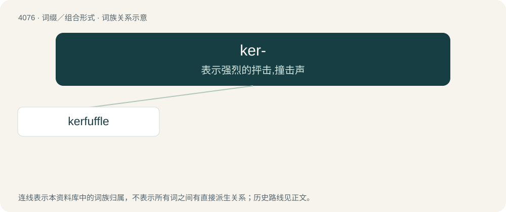

# 4088 · ker- — 表示强烈的抨击,撞击声

[总目录](../00_总目录_按常用程度.md)

**类型**：词缀／组合形式　｜　**来源语言**：见词源记录

## 核心含义与来源

- 核心含义：表示强烈的抨击,撞击声
- 英文含义：Used to form various onomatopoeias imitating the effect or sound of a heavy object falling.
- 词形：ker-

**来源记录 1**（前缀／前置成分；Used to form various onomatopoeias imitating the effect or sound of a heavy object falling.）

Now stands in for a thud. Originally Scots, possibly continuing Scottish Gaelic car (“somewhat”), cognate with Irish cor. Early uses were often collocated with went.

## 词族图

## 单词速览（常用到不常用）

| 单词 | 音标 | 释义 |
|---|---|---|
| [kerfuffle](#w-1) | 英 /kəˈfʌfəl/；美 /kɚˈfʌfəl/ | n. 混乱, 动乱；v. 使混乱,弄乱 |

## 逐词详解

### 1. kerfuffle

**词性**：名词　｜　**音标**：英 /kəˈfʌfəl/；美 /kɚˈfʌfəl/

**中文释义**：n. 混乱, 动乱；v. 使混乱,弄乱

**英文义项**：A disorderly outburst, disturbance, commotion, or tumult.

**构词拆分**：ker- + fuffle

**词源与演化**：

Probably from Scots curfuffle, equivalent to ker- + fuffle, or related to Irish cíor thuathail (“confusion, bewilderment”). Similar to modern Welsh cythrwfl (“uproar, trouble, agitation”)

**例句**：

> Tom caused a kerfuffle at the dinner last night.
