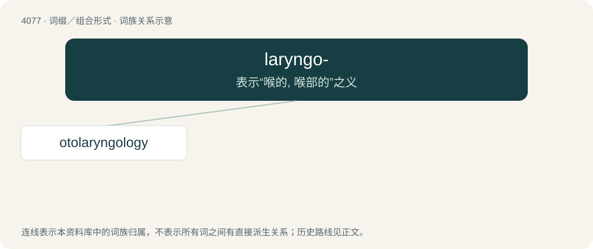

# 4089 · laryngo- — 表示“喉的, 喉部的”之义

[总目录](../00_总目录_按常用程度.md)

**类型**：词缀／组合形式　｜　**来源语言**：见词源记录

## 核心含义与来源

- 核心含义：表示“喉的, 喉部的”之义
- 英文含义：Of the throat or larynx.
- 词形：laryngo-

## 词族图

## 单词速览（常用到不常用）

| 单词 | 音标 | 释义 |
|---|---|---|
| [otolaryngology](#w-1) | 英 /ˌəʊtə(ʊ)ˌlæɹɪŋˈɡɒləd͡ʒi/；美 /ˌoʊtoʊˌlɛɹɪŋˈɡɑləd͡ʒi/ | n. 耳鼻喉科学；\[医\] 耳鼻喉科学 |

## 逐词详解

### 1. otolaryngology

**词性**：名词　｜　**音标**：英 /ˌəʊtə(ʊ)ˌlæɹɪŋˈɡɒləd͡ʒi/；美 /ˌoʊtoʊˌlɛɹɪŋˈɡɑləd͡ʒi/

**中文释义**：n. 耳鼻喉科学；\[医\] 耳鼻喉科学

**英文义项**：The study of diseases of the ear, nose and throat.

**构词拆分**：oto- + laryngo- + -logy

**词源与演化**：

From oto- (“ear”) + laryngo- (“throat”) + -logy.
