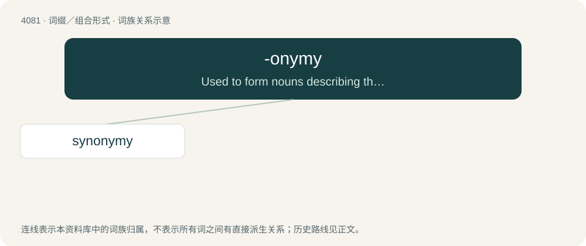

# 4093 · -onymy — Used to form nouns describing the study, formation, or use of words or names.

[总目录](../00_总目录_按常用程度.md)

**类型**：词缀／组合形式　｜　**来源语言**：见词源记录

## 核心含义与来源

- 核心含义：Used to form nouns describing the study, formation, or use of words or names.
- 英文含义：Used to form nouns describing the study, formation, or use of words or names.
- 词形：-onymy

**来源记录 1**（后缀／后置成分；Used to form nouns describing the study, formation, or use of words or names.）

From international scientific vocabulary, reflecting a New Latin combining form (-onymia), from Ancient Greek ὄνομα (ónoma, “name”)/Ancient Greek ὄνυμα (ónuma, “name”) (whence also onoma) + -ia; compare also ὄνομα § Derived terms.

## 词族图

## 单词速览（常用到不常用）

| 单词 | 音标 | 释义 |
|---|---|---|
| [synonymy](#w-1) | /sɪˈnɒnəmi/ | n. 同义, 同义字重复, 同义字研究 |

## 逐词详解

### 1. synonymy

**词性**：名词　｜　**音标**：/sɪˈnɒnəmi/

**中文释义**：n. 同义, 同义字重复, 同义字研究

**英文义项**：A certain degree of similarity between the meaning(s) of several (synonymous) words or phrases. (See Usage notes below.) / A list or collection of synonyms, often compared and contrasted.

**构词拆分**：syn- + -onymy

**词源与演化**：

From French synonymie and its etymon Late Latin synōnymia, from Ancient Greek συνωνυμία (sunōnumía), from συνώνυμος (sunṓnumos, “of like name”) + -ία (-ía, abstract noun suffix). By surface analysis, synonym + -y or syn- + -onymy. Doublet of synonymia.

**例句**：

> Descriptions are followed by a synonymy of the names that have been applied in the literature .

该用例对应义项：A group or list of synonyms.
