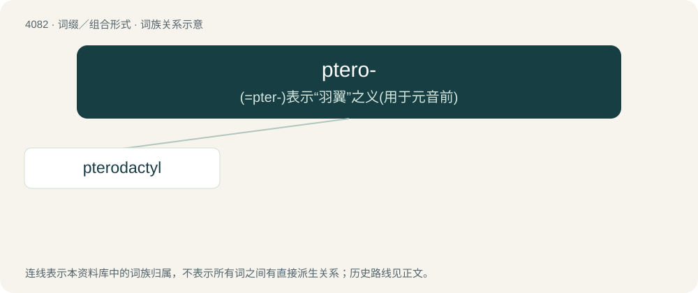

# 4095 · ptero- — (=pter-)表示“羽翼”之义(用于元音前)

[总目录](../00_总目录_按常用程度.md)

**类型**：词缀／组合形式　｜　**来源语言**：见词源记录

## 核心含义与来源

- 核心含义：(=pter-)表示“羽翼”之义(用于元音前)
- 英文含义：wing
- 词形：ptero-

**来源记录 1**（前缀／前置成分；wing）

From Ancient Greek πτερόν (pterón, “wing, feather”).

## 词族图

## 单词速览（常用到不常用）

| 单词 | 音标 | 释义 |
|---|---|---|
| [pterodactyl](#w-1) | 美 /ˌtɛɹ.əˈdæk.təl/ | n. 翼手龙 |

## 逐词详解

### 1. pterodactyl

**词性**：名词　｜　**音标**：美 /ˌtɛɹ.əˈdæk.təl/

**中文释义**：n. 翼手龙

**英文义项**：A pterosaur of the genus Pterodactylus. / Any pterosaur.

**构词拆分**：By surface analysis, ptero- + -dactyl

**词源与演化**：

From French ptérodactyle, a term coined by Cuvier from Ancient Greek πτερόν (pterón, “wing”) + δάκτυλος (dáktulos, “finger”). By surface analysis, ptero- + -dactyl.
