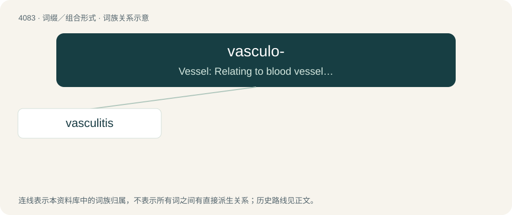

# 4096 · vasculo- — Vessel: Relating to blood vessels, lymphatic vessels, or both.

[总目录](../00_总目录_按常用程度.md)

**类型**：词缀／组合形式　｜　**来源语言**：见词源记录

## 核心含义与来源

- 核心含义：Vessel: Relating to blood vessels, lymphatic vessels, or both.
- 英文含义：Vessel: Relating to blood vessels, lymphatic vessels, or both.
- 词形：vasculo-

**来源记录 1**（前缀／前置成分；Vessel: Relating to blood vessels, lymphatic vessels, or both.）

From New Latin vasculāris, from Latin vasculum.

## 词族图

## 单词速览（常用到不常用）

| 单词 | 音标 | 释义 |
|---|---|---|
| [vasculitis](#w-1) | /ˌvæskjʊˈlaɪtɪs/ | \[医\] 结节性脉管炎 |

## 逐词详解

### 1. vasculitis

**词性**：名词　｜　**音标**：/ˌvæskjʊˈlaɪtɪs/

**中文释义**：\[医\] 结节性脉管炎

**英文义项**：A group of diseases featuring inflammation of the wall of blood vessels.

**构词拆分**：vasculo- + -itis

**词源与演化**：

From vasculo- + -itis.
