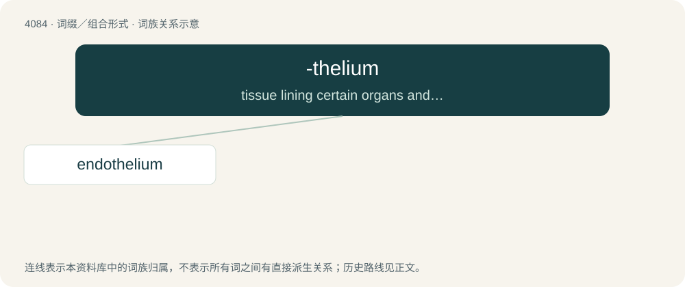

# 4098 · -thelium — tissue lining certain organs and vessels

[总目录](../00_总目录_按常用程度.md)

**类型**：词缀／组合形式　｜　**来源语言**：见词源记录

## 核心含义与来源

- 核心含义：tissue lining certain organs and vessels
- 英文含义：tissue lining certain organs and vessels
- 词形：-thelium

**来源记录 1**（后缀／后置成分；tissue lining certain organs and vessels）

From epithelium, see there. By surface analysis, thel- + -ium.

## 词族图

## 单词速览（常用到不常用）

| 单词 | 音标 | 释义 |
|---|---|---|
| [endothelium](#w-1) | /.endəuˈθiːliəm/ | n. 内皮, 内种皮；\[医\] 内皮 |

## 逐词详解

### 1. endothelium

**词性**：名词　｜　**音标**：/.endəuˈθiːliəm/

**中文释义**：n. 内皮, 内种皮；\[医\] 内皮

**英文义项**：A thin layer of flat epithelial cells that lines the heart, serous cavities, lymph vessels, and blood vessels.

**构词拆分**：endo- + -thelium

**词源与演化**：

From endo- + -thelium, as in epithelium.
