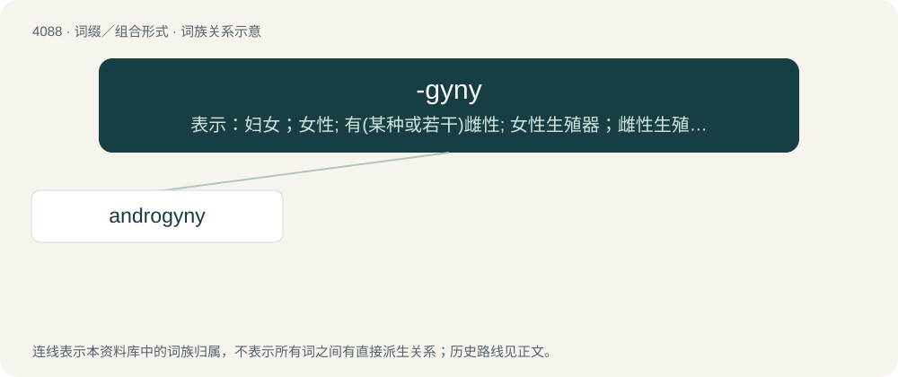

# 4100 · -gyny — 表示：妇女；女性; 有(某种或若干)雌性; 女性生殖器；雌性生殖器；雌蕊

[总目录](../00_总目录_按常用程度.md)

**类型**：词缀／组合形式　｜　**来源语言**：见词源记录

## 核心含义与来源

- 核心含义：表示：妇女；女性; 有(某种或若干)雌性; 女性生殖器；雌性生殖器；雌蕊
- 英文含义：the state of having a specific number of wives
- 词形：-gyny

**来源记录 1**（后缀／后置成分；the state of having a specific number of wives）

From Ancient Greek γυνή (gunḗ, “woman, female”).

## 词族图

## 单词速览（常用到不常用）

| 单词 | 音标 | 释义 |
|---|---|---|
| [androgyny](#w-1) | 英 /ænˈdɹɒdʒəni/；美 /ænˈdɹɑd͡ʒəni/ | \[医\] 两性畸形, 雌雄同体性, 男子女化(男性假两性畸形) |

## 逐词详解

### 1. androgyny

**词性**：名词　｜　**音标**：英 /ænˈdɹɒdʒəni/；美 /ænˈdɹɑd͡ʒəni/

**中文释义**：\[医\] 两性畸形, 雌雄同体性, 男子女化(男性假两性畸形)

**英文义项**：Hermaphroditism. / The state of having traits of both male and female genders.

**构词拆分**：andro- + -gyny

**词源与演化**：

From andro- + -gyny. See androgynous.
