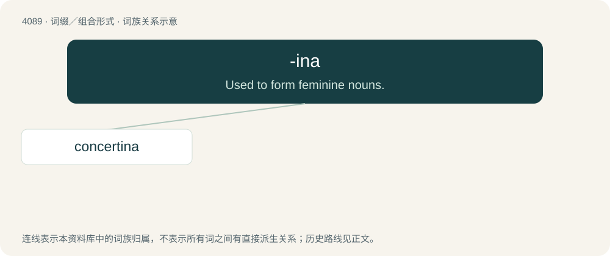

# 4101 · -ina — Used to form feminine nouns.

[总目录](../00_总目录_按常用程度.md)

**类型**：词缀／组合形式　｜　**来源语言**：见词源记录

## 核心含义与来源

- 核心含义：Used to form feminine nouns.
- 英文含义：Used to form feminine nouns.
- 词形：-ina

**来源记录 1**（后缀／后置成分；Used to form feminine nouns.）

From Italian -ina and its etymon Classical Latin -īna. In some instances perhaps also partly via Spanish -ina. Doublet of -ine.

## 词族图

## 单词速览（常用到不常用）

| 单词 | 音标 | 释义 |
|---|---|---|
| [concertina](#w-1) | 英 /ˌkɒnsəˈtiːnə/；美 /ˌkɑnsɚˈtinə/ | n. 六角形手风琴 |

## 逐词详解

### 1. concertina

**词性**：动词　｜　**音标**：英 /ˌkɒnsəˈtiːnə/；美 /ˌkɑnsɚˈtinə/

**中文释义**：n. 六角形手风琴

**英文义项**：To become compressed into a shape reminiscent of a concertina. / To be drawn closer and farther apart repeatedly, or up and down, as if situated on a working concertina's folds.

**构词拆分**：concert + -ina

**词源与演化**：

From concert + -ina.

**例句**：

> The car concertinaed into the wall.

该用例对应义项：To become compressed into a shape reminiscent of a concertina.
