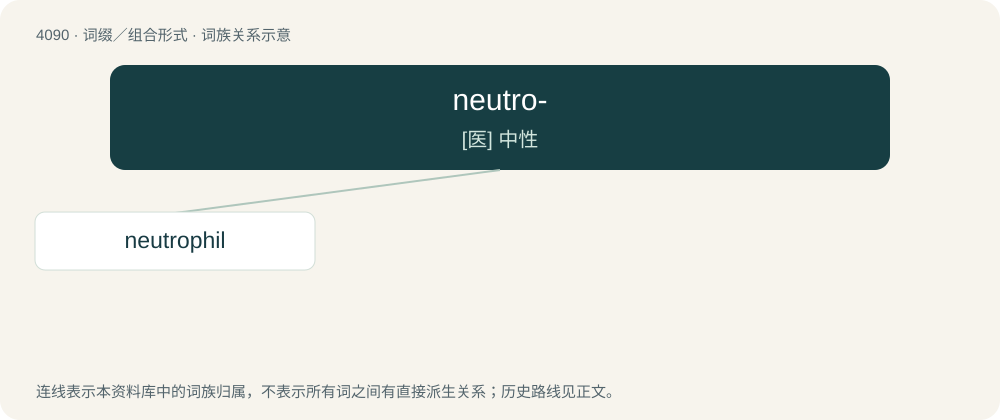

# 4102 · neutro- — \[医\] 中性

[总目录](../00_总目录_按常用程度.md)

**类型**：词缀／组合形式　｜　**来源语言**：见词源记录

## 核心含义与来源

- 核心含义：\[医\] 中性
- 英文含义：Neutral.
- 词形：neutro-

**来源记录 1**（前缀／前置成分；Neutral.）

From Latin neutralis (“neuter”).

## 词族图

## 单词速览（常用到不常用）

| 单词 | 音标 | 释义 |
|---|---|---|
| [neutrophil](#w-1) | 英 /ˈnjuːtɹəfɪl/ | a. 嗜中性的；n. 嗜中性白细胞, 嗜中性白血球 |

## 逐词详解

### 1. neutrophil

**词性**：形容词　｜　**音标**：英 /ˈnjuːtɹəfɪl/

**中文释义**：a. 嗜中性的；n. 嗜中性白细胞, 嗜中性白血球

**英文义项**：Of a cell: being more easily or more fully stained by neutral dyes than by acidic or alkaline (basic) ones.

**构词拆分**：neutro- + -phil

**词源与演化**：

From German Neutrophil, from neutro- (“neutro-”) + -phil (“-phile”), equivalent to neutro- + -phil.
