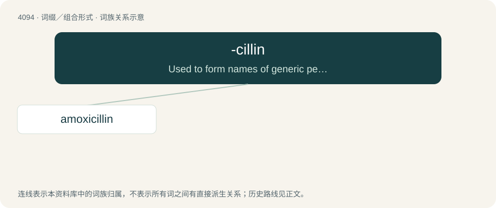

# 4103 · -cillin — Used to form names of generic penicillin antibiotic drugs.

[总目录](../00_总目录_按常用程度.md)

**类型**：词缀／组合形式　｜　**来源语言**：见词源记录

## 核心含义与来源

- 核心含义：Used to form names of generic penicillin antibiotic drugs.
- 英文含义：Used to form names of generic penicillin antibiotic drugs.
- 词形：-cillin

**来源记录 1**（后缀／后置成分；Used to form names of generic penicillin antibiotic drugs.）

From penicillin.

## 词族图

## 单词速览（常用到不常用）

| 单词 | 音标 | 释义 |
|---|---|---|
| [amoxicillin](#w-1) | 英 /əˌmɒk.sɪˈsɪl.ɪn/；美 /əˌmak.sɪˈsɪlːɪn/ | \[化\] 阿莫西林; 羟氨苄青霉素 |

## 逐词详解

### 1. amoxicillin

**词性**：名词　｜　**音标**：英 /əˌmɒk.sɪˈsɪl.ɪn/；美 /əˌmak.sɪˈsɪlːɪn/

**中文释义**：\[化\] 阿莫西林; 羟氨苄青霉素

**英文义项**：A moderate-spectrum, bacteriolytic beta-lactam antibiotic with the formula C₁₆H₁₉N₃O₅S, closely related to ampicillin.

**构词拆分**：ampicillin + oxy- + -cillin

**词源与演化**：

From am(picillin) + (hydr)oxy + -cillin.
