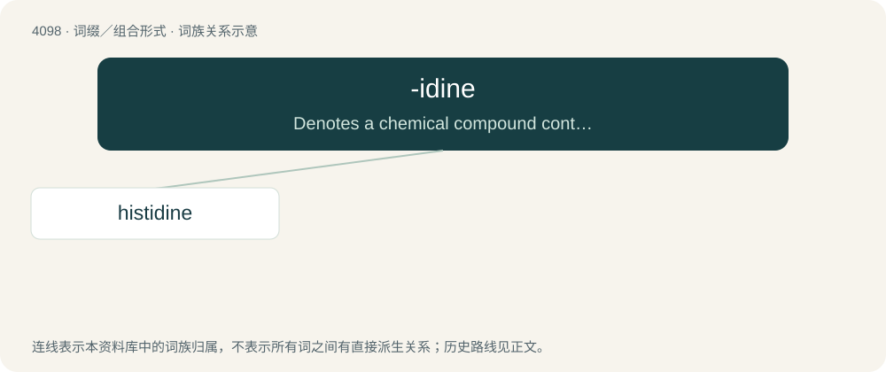

# 4109 · -idine — Denotes a chemical compound containing a ring containing nitrogen

[总目录](../00_总目录_按常用程度.md)

**类型**：词缀／组合形式　｜　**来源语言**：见词源记录

## 核心含义与来源

- 核心含义：Denotes a chemical compound containing a ring containing nitrogen
- 英文含义：Denotes a chemical compound containing a ring containing nitrogen
- 词形：-idine

**来源记录 1**（后缀／后置成分；Denotes a chemical compound containing a ring containing nitrogen）

Derived from the ending of pyridine, which comes from German Pyridin which in turn comes from a combination of pyro- -id and -in (-ide and -ine)

## 词族图

## 单词速览（常用到不常用）

| 单词 | 音标 | 释义 |
|---|---|---|
| [histidine](#w-1) | /ˈhɪstɪdiːn/ | n. \[生化\]组氨酸, 组织氨基酸 |

## 逐词详解

### 1. histidine

**词性**：名词　｜　**音标**：/ˈhɪstɪdiːn/

**中文释义**：n. \[生化\]组氨酸, 组织氨基酸

**英文义项**：An essential amino acid C₆H₉N₃O₂ found in most animal proteins; essential for tissue growth and repair.

**构词拆分**：histo- + -idine

**词源与演化**：

From histo- + -idine.
