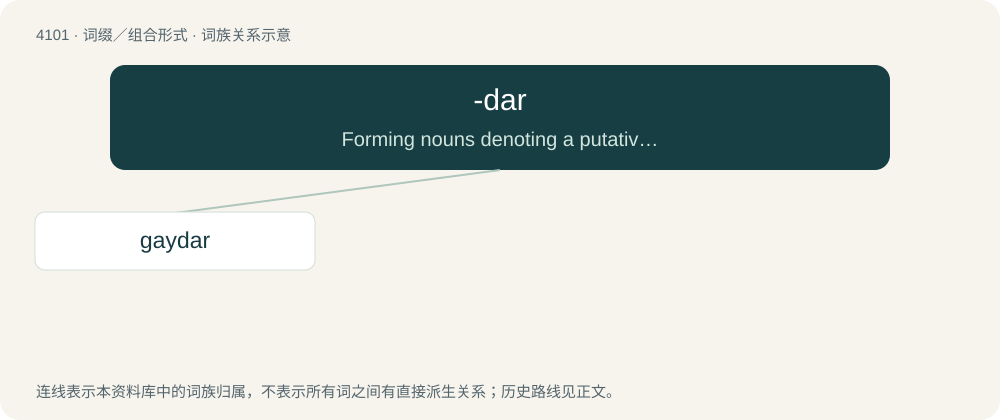

# 4111 · -dar — Forming nouns denoting a putative ability to detect a thing.

[总目录](../00_总目录_按常用程度.md)

**类型**：词缀／组合形式　｜　**来源语言**：见词源记录

## 核心含义与来源

- 核心含义：Forming nouns denoting a putative ability to detect a thing.
- 英文含义：Forming nouns denoting a putative ability to detect a thing.
- 词形：-dar

**来源记录 1**（后缀／后置成分；Forming nouns denoting a putative ability to detect a thing.）

Probably from rebracketing of gaydar, itself a blend of gay + radar. Alternatively radar might have been rebracketed directly as ray + -dar, but this appears less likely because rays are, if anything, that by means of which a radar detects things.

## 词族图

## 单词速览（常用到不常用）

| 单词 | 音标 | 释义 |
|---|---|---|
| [gaydar](#w-1) | 英 /ˈɡeɪdɑː/；美 /ˈɡeɪˌdɑɹ/ | n. 同性恋行为 |

## 逐词详解

### 1. gaydar

**词性**：名词　｜　**音标**：英 /ˈɡeɪdɑː/；美 /ˈɡeɪˌdɑɹ/

**中文释义**：n. 同性恋行为

**英文义项**：The supposed ability to detect whether or not a person is gay by observing that person's appearance, mannerisms, etc.

**构词拆分**：gay + -dar

**词源与演化**：

Blend of gay + radar, equivalent to gay + -dar.

**例句**：

> Where was Rima's gaydar when she started dating Ziri?
