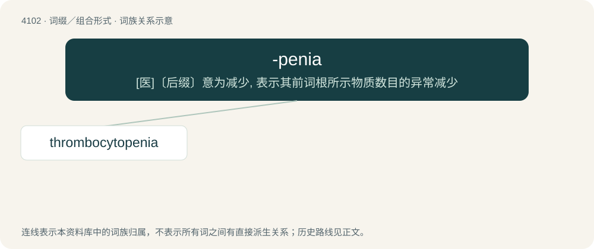

# 4112 · -penia — \[医\]〔后缀〕意为减少, 表示其前词根所示物质数目的异常减少

[总目录](../00_总目录_按常用程度.md)

**类型**：词缀／组合形式　｜　**来源语言**：见词源记录

## 核心含义与来源

- 核心含义：\[医\]〔后缀〕意为减少, 表示其前词根所示物质数目的异常减少
- 英文含义：deficiency
- 词形：-penia

**来源记录 1**（后缀／后置成分；deficiency）

Borrowed from Ancient Greek πενῐ́ᾱ (penĭ́ā, “poverty, lack”).

## 词族图

## 单词速览（常用到不常用）

| 单词 | 音标 | 释义 |
|---|---|---|
| [thrombocytopenia](#w-1) | 英 /ˌθrɒm.bə.sʌɪ.təˈpiːniə/ | n. 血小板减少症；\[医\] 血小板减少 |

## 逐词详解

### 1. thrombocytopenia

**词性**：名词　｜　**音标**：英 /ˌθrɒm.bə.sʌɪ.təˈpiːniə/

**中文释义**：n. 血小板减少症；\[医\] 血小板减少

**英文义项**：An abnormally low number of platelets in the blood.

**构词拆分**：thrombocyte + -o- + -penia

**词源与演化**：

From thrombocyte + -o- + -penia.
