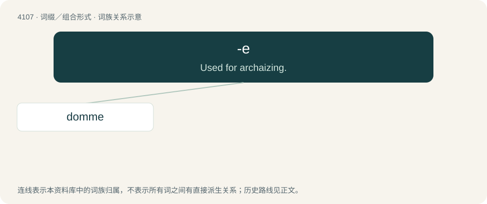

# 4118 · -e — Used for archaizing.

[总目录](../00_总目录_按常用程度.md)

**类型**：词缀／组合形式　｜　**来源语言**：见词源记录

## 核心含义与来源

- 核心含义：Used for archaizing.
- 英文含义：Used for archaizing.
- 词形：-e

**来源记录 1**（后缀／后置成分；Used for archaizing.）

From archaic forms ending in e, from Middle English -e, from the coalescence of multiple various endings from Old English.

## 词族图

## 单词速览（常用到不常用）

| 单词 | 音标 | 释义 |
|---|---|---|
| [domme](#w-1) | 英 /dɒm/；美 /dɑm/ | 【英文】A female dominant in a sadomasochistic relationship. |

## 逐词详解

### 1. domme

**词性**：名词　｜　**音标**：英 /dɒm/；美 /dɑm/

**英文义项**：A female dominant in a sadomasochistic relationship.

**构词拆分**：dom + French -e (feminine suffix)

**词源与演化**：

Pseudo-Gallicism, derived from dom + French -e (feminine suffix). The correct word in French is dominatrice.
