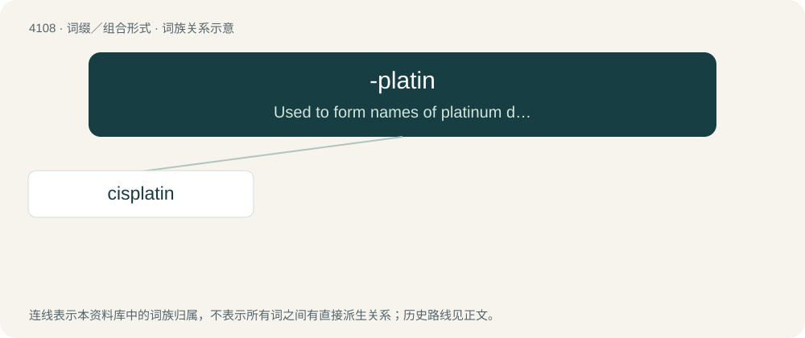

# 4119 · -platin — Used to form names of platinum derivatives used as antineoplastic agents.

[总目录](../00_总目录_按常用程度.md)

**类型**：词缀／组合形式　｜　**来源语言**：见词源记录

## 核心含义与来源

- 核心含义：Used to form names of platinum derivatives used as antineoplastic agents.
- 英文含义：Used to form names of platinum derivatives used as antineoplastic agents.
- 词形：-platin

**来源记录 1**（后缀／后置成分；Used to form names of platinum derivatives used as antineoplastic agents.）

From platinum.

## 词族图

## 单词速览（常用到不常用）

| 单词 | 音标 | 释义 |
|---|---|---|
| [cisplatin](#w-1) | /sɪsˈplæt.ɪn/ | \[医\]顺-二氯二氨络铂, 顺铂, 顺氯氨铂, 氯氨铂 |

## 逐词详解

### 1. cisplatin

**词性**：名词　｜　**音标**：/sɪsˈplæt.ɪn/

**中文释义**：\[医\]顺-二氯二氨络铂, 顺铂, 顺氯氨铂, 氯氨铂

**英文义项**：A platinum-containing antineoplastic drug cis-diamminedichloro-platinum(II) (Cl₂H₆N₂Pt) that is cytotoxic and is used especially in the treatment of testicular and ovarian tumors and advanced bladder cancer. / A platin, that is, a platinum-based antineoplastic, of which the class cisplatin is the archetypal member.

**构词拆分**：cis- + -platin

**词源与演化**：

From cis- + -platin (“platinum derivative”).
