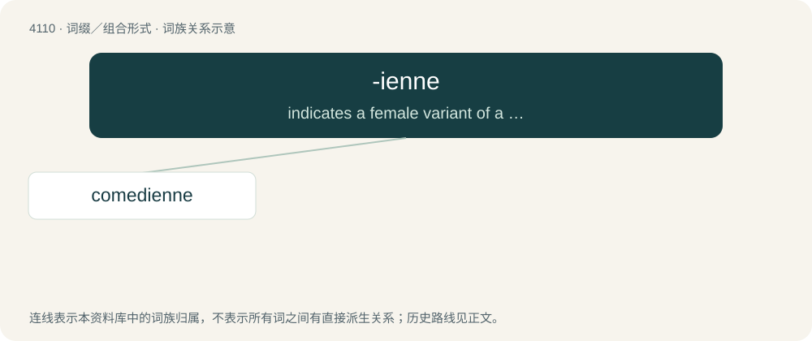

# 4121 · -ienne — indicates a female variant of a noun ending in -ian

[总目录](../00_总目录_按常用程度.md)

**类型**：词缀／组合形式　｜　**来源语言**：见词源记录

## 核心含义与来源

- 核心含义：indicates a female variant of a noun ending in -ian
- 英文含义：indicates a female variant of a noun ending in -ian
- 词形：-ienne

**来源记录 1**（后缀／后置成分；indicates a female variant of a noun ending in -ian）

Borrowed from French -ienne, feminine of -ien (“-ian”).

## 词族图

## 单词速览（常用到不常用）

| 单词 | 音标 | 释义 |
|---|---|---|
| [comedienne](#w-1) | 英 /kəˌmiːdɪˈɛn/；美 /kəˌmiːdiˈɛn/ | n. 喜剧女演员 |

## 逐词详解

### 1. comedienne

**词性**：名词　｜　**音标**：英 /kəˌmiːdɪˈɛn/；美 /kəˌmiːdiˈɛn/

**中文释义**：n. 喜剧女演员

**英文义项**：A female comedian.

**构词拆分**：comedy + -ienne

**词源与演化**：

Borrowed from French comédienne, equivalent to comedy + -ienne. Compare doyenne.
